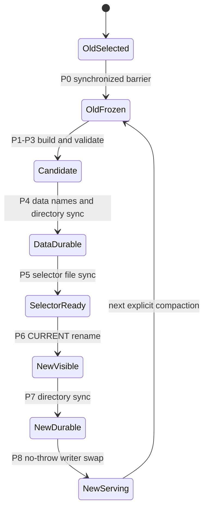
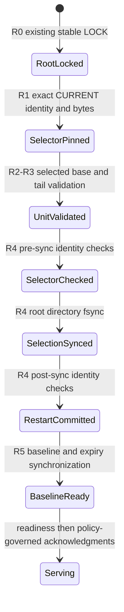

# AOF compaction architecture — Stage 6B.0C accepted design

Status: **INDEPENDENTLY ACCEPTED AT ARCHITECTURE LEVEL; DESIGN ONLY**
(2026-10-27). The user reports that the revised Stage 6B.0B design passed
independent architectural review. This publishes that acceptance; it does not
approve a byte-exact V2 format or production implementation. V2 has not been
implemented or dynamically tested. Original Phase 10A/10B and 10C–10G are not
marked complete. Section 13 records the review disposition and remaining gates.

## 1. Verified baseline, scope and evidence

Repository: `sinthetaaa/redis-compatible-in-memory-database`; local root:
`/Users/sinthetaaa/Desktop/Projects/SDE-Projects/RedisCompatibleDB`.
Stage 6B.0A verified GitHub identity: `sinthetaaa`. At 6B.0A entry the worktree was clean;
local `main`, fetched `origin/main`, and `git ls-remote` main all equaled
`65a495a42df1e1bc73268137c3124852d76f71e5`. The design branch was absent
locally and remotely, then created from exactly that commit as
`fasttrack/aof-compaction-design`. Main is unchanged.

GitHub run metadata was independently queried during the 6B.0A audit: each run was
completed, successful, on `main`, at that exact SHA:

| Accepted Stage 6A closure run | Result verified in 6B.0A |
|---|---|
| [Networking 40384462761](https://github.com/sinthetaaa/redis-compatible-in-memory-database/actions/runs/40384462761) | success, exact main SHA |
| [ASan/UBSan/fuzz 40384462817](https://github.com/sinthetaaa/redis-compatible-in-memory-database/actions/runs/40384462817) | success, exact main SHA |
| [Docker Linux 40384462849](https://github.com/sinthetaaa/redis-compatible-in-memory-database/actions/runs/40384462849) | success, exact main SHA |

Accepted baseline evidence supplied for those runs: Debug 79/79, Release 79/79,
sanitizer 80/80, 10,000 fuzz executions, Redis compatibility and Docker checks.
That audit verified run association/conclusion; it did not rerun those workloads
or newly inspect every historical execution log. No new performance experiment,
C++ build, CTest, sanitizer, Docker or fuzz execution is claimed here.

Authoritative context: [README](../README.md), [roadmap](ROADMAP.md),
[project state](PROJECT_STATE.md), [handoff](CONTINUATION_HANDOFF.md),
[architecture](ARCHITECTURE.md), [decisions](DECISIONS.md), [AOF](AOF.md),
[snapshots](SNAPSHOTS.md), [benchmarks](BENCHMARKS.md). Several documents still
describe the earlier Stage 6A closure preparation and `bf1f19f...`; current Git
and the verified closure SHA above supersede those dated continuation statements.
Historical sections are preserved. Original roadmap: 20 phases, 169 subphases.
Original Phases 11/12 and Stage 6A are closed. **Original Phase 16 actual remote
deployment is excluded, not completed.** Stages 6C–6E remain later work.

At 6B.0B entry, the branch/HEAD/main/origin/main still matched the recorded
accepted SHA; only the existing uncommitted draft and handoff differed. Origin
was unchanged. No fresh network fetch or CI execution is claimed for 6B.0B.

Stage 6B.0C freshly fetched origin and verified authenticated GitHub identity
`sinthetaaa`, the correct origin, and HEAD/local main/origin/main/remote main at
the accepted SHA. The remote design branch was absent; exactly these two
documentation files differed. One normal documentation commit and feature push
are authorized after validation, followed by exact-feature-head Linux CI review.
No PR, merge, infrastructure or persistence implementation/data operation is
authorized. Publication metadata and new CI outcomes must be read from Git and
the publication report; historical run results above remain historical evidence.

## 2. Actual persistence contracts at accepted main

Source links and line numbers below refer to the accepted baseline above; ranges
in prose identify the inspected implementation, not a stable future API. These
contracts take precedence over earlier sketches of separate writer/reader modules.

| Contract | Source and observed behavior |
|---|---|
| AOF ownership | [AofLog.hpp:50](../include/redisdb/persistence/AofLog.hpp#L50), [constructor:318](../src/persistence/AofLog.cpp#L318) (318–403): noncopyable RAII descriptor, `O_RDWR\|O_APPEND`, owner-only exclusive creation, `O_NOFOLLOW`, regular-file `fstat`, nonblocking open of existing paths, `flock(LOCK_EX\|LOCK_NB)` on the journal inode. Parent directory opened separately. Existing files are never truncated/repaired. Advisory locking assumes cooperating writers and trusted ancestors. |
| Codec | [encode_effects:156](../src/persistence/AofLog.cpp#L156), [decode_effects:229](../src/persistence/AofLog.cpp#L229) (156–316): changed-key replacements/tombstones, not incoming Redis commands. Binary strings, four value types, absolute deadlines. Writer sorts effects/hash fields/set members; decoder requires sorted unique effect keys and rejects duplicate hash fields/set members, but does not require their incoming order to be canonical. |
| Record sequencing | [append:570](../src/persistence/AofLog.cpp#L570) (570–611): one nonempty committed-effects set per consecutive sequence; empty effects emit no bytes. Sequence starts at 1 and exhaustion fails. Offset overflow is checked. CRC is accumulated over exact serialized history. |
| Watermark | [publish_watermark:425](../src/persistence/AofLog.cpp#L425) (425–450): temporary `mkstemp`, complete write, file fsync, rename over `.commit`, parent fsync, then update in-memory durable coordinates. Old marker is authoritative until rename; a rename/sync failure is uncertain and fatal. Only the exact operation-owned temporary is unlinked on unwind. |
| Synchronization | [flush/tick/checkpoint/finish:613](../src/persistence/AofLog.cpp#L613) (613–651): flush fsyncs journal then publishes watermark. `always` flushes in append; `everysec` flushes pending records when a monotonic deadline is checked on a loop turn; `no` has no periodic flush. Checkpoint and checked clean shutdown flush pending work under every policy. Creation syncs header and directory via watermark publication; recovery syncs baseline before readiness. |
| Acknowledgment | [server:181](../src/server/RespCommandServer.cpp#L181) (181–218): execute tentatively, form effects, append/required sync, allocation-free transaction commit, return reply to pipeline. Persistence latch is checked before any later callback and after poll (163–165, 263–269). A complete logged operation can recover without a reply, including response allocation/socket failure after commit. No exactly-once client promise. |
| Transaction rollback | [Database::Transaction:73](../src/storage/Database.cpp#L73) (73–203), [Database.hpp:263](../include/redisdb/storage/Database.hpp#L263): noeviction keeps first preimages/expiry nodes for touched keys; exact LRU keeps a full database clone and original iterators. Destructor rolls tentative memory back without allocation; commit sets a flag. Effects compare value/deadline, include eviction victims, and include full current LRU order on data changes in LRU mode. Dispatcher error replies leave transaction uncommitted. |
| Failure distinction | [server:200](../src/server/RespCommandServer.cpp#L200), [append catch:607](../src/persistence/AofLog.cpp#L607): preparation/effects allocation exceptions roll memory back; they are not all journal failures. Once append is called, even encoding/allocation exceptions latch the journal and server persistence failure. Snapshot publication catches all failures and poisons the store. No successful later operation may be acknowledged after persistence failure. |
| Snapshot generation/locks | [SnapshotStore constructor:119](../src/persistence/Snapshot.cpp#L119) (119–170), [publish:228](../src/persistence/Snapshot.cpp#L228) (228–285): dedicated real directory, regular nonsymlink LOCK, exclusive advisory lock. Next candidate increments from selected generation and skips occupied names; gaps legal; overflow fatal. Check-then-rename relies on exclusive cooperative ownership/trusted directory. All final old and abandoned candidates are retained. |
| CURRENT | [select:209](../src/persistence/Snapshot.cpp#L209) (209–225): single checksummed selector, temp write/fsync, rename, directory fsync, then report success. First initialization durably selects zero. Final `generation-*` artifacts without CURRENT reject startup; temporaries alone permit initialization retry. Never select highest filename or fallback to another snapshot. |
| Snapshot checkpoint | [publish:233](../src/persistence/Snapshot.cpp#L233): `journal.checkpoint()` precedes capture; it includes pending weaker-policy writes. Header records sequence, offset, last-record CRC and full-prefix CRC. Capture neither expires nor touches entries. Data fsync/rename/directory fsync precede selector publication. |
| Recovery linkage | [restore:289](../src/persistence/Snapshot.cpp#L289) (289–383), [recover:469](../src/persistence/AofLog.cpp#L469) (469–567), [server startup:111](../src/server/RespCommandServer.cpp#L111): restore selected snapshot into fresh database, require existing AOF when checkpoint positive, validate header/watermark, stream **entire** original AOF, decode historical effects too, compare all four checkpoint coordinates, validate watermark record boundary, apply only later records. No replacement AOF is created for a selected snapshot. |
| Fail-closed tails | [recover:499](../src/persistence/AofLog.cpp#L499): all frames through EOF must validate, even beyond durable watermark. Partial/unacknowledged tail, checksum/trailer/sequence error or loss of synchronized suffix rejects startup without automatic salvage. Complete valid records beyond marker may replay; watermark is a durable lower bound, not a replay cutoff. CRC32C is corruption detection, not authentication. |
| Expiration | [deadline codec:34](../src/persistence/AofLog.cpp#L34), [encode:185](../src/persistence/AofLog.cpp#L185), [finish_recovery:299](../src/storage/Database.cpp#L299), [recovery cleanup:548](../src/persistence/AofLog.cpp#L548): signed Unix microseconds, native-clock range checked, floor <1 µs on nanosecond platforms never extends TTL. Restore physical entries/index first; remove due entries and journal tombstones before readiness, enforce live budget without eviction, flush cleanup even under weak policies. Later startup must not resurrect removed keys. |
| Command clocks/maintenance | [CommandClock:57](../src/server/RespCommandServer.cpp#L57), [maintenance:270](../src/server/RespCommandServer.cpp#L270): freeze one wall sample across persistent command due-expiry check and execution. Lazy-expiry reads can mutate and need transactions. Active sweep: at most 32 expiry checks per nominal 100 ms turn, serialized with commands. Signal handlers only set flags. |
| LRU restoration | [replay_effects:209](../src/storage/Database.cpp#L209), [snapshot_order:273](../src/storage/Database.cpp#L273), [snapshot restore:353](../src/persistence/Snapshot.cpp#L353): oldest-to-newest exact permutation, iterators reconstructed. AOF data commits capture prior read touches; reads alone do not append. Snapshots capture current read recency. No-LRU history restored under LRU uses binary sorted cold order. Snapshot LRU permutation is validated even under noeviction; AOF replay checks permutation against keyspace only under configured LRU. Historical prefix codec validation is not full semantic replay of prefix LRU states. |
| Accounting | [MemoryAccounting.hpp:10](../include/redisdb/storage/MemoryAccounting.hpp#L10), [MemoryAccounting.cpp:10](../src/storage/MemoryAccounting.cpp#L10), [commit_entries:312](../src/storage/Database.cpp#L312): V1 deterministic policy units, not RSS. Charge = 64 + key bytes + value charge, plus 48 + key bytes for expiry. List element 48, hash field 80, set member 56 plus payload bytes. Checked totals; charge equals physically resident entries, including expired entries until erased. Restore recomputes charges/expiry index, checks snapshot total before expiry cleanup. No persisted allocator capacities or iterators. |
| Capture scaling | [visit_snapshot:258](../src/storage/Database.cpp#L258), [snapshot publish:242](../src/persistence/Snapshot.cpp#L242): O(K log K) sorted key views; copied LRU keys; copied/encoded one entry at a time with bounded frame buffers. Capture is serialized and blocks loop. Temporary encoding/undo/index memory lies outside maxmemory. |
| Configuration/lifecycle | [main:189](../src/main.cpp#L189) (189–223), [server:287](../src/server/RespCommandServer.cpp#L287) (287–316): startup-only persistence options, snapshots require AOF. SIGUSR1 publishes snapshot during maintenance, success marker follows final directory sync. SIGINT/SIGTERM drain networking for up to one second then `finish()`; blocking filesystem work is outside that bound. SIGKILL has no finish. |

### 2.1 Exact V1 encodings

All integer fields are big-endian, no native layouts. Header: 20 bytes,
`RDBAOF01` (8), version u32=1, flags u32=0, CRC32C (4) of first 16 bytes.
Transaction: `TXN1` (4), consecutive sequence u64, payload length u32,
payload, record CRC32C u32 of 16-byte record header plus payload, `END!` (4).
Thus record overhead outside payload is **24 bytes**.

Payload: changed-key count u32; sorted effects with length-prefixed key, tag
0=tombstone / 1=string / 2=list / 3=hash / 4=set. Replacement includes expiry
flag u8 and optional signed i64 absolute deadline; value uses length-prefixed
binary blobs and collection counts. End: LRU flag u8, order count u32, keys.
Empty transactions/collections and duplicate effect keys/fields/members reject.
Bounds: payload 64 MiB, blob 8 MiB, effects/items/LRU keys each 1,048,576.
These are persistence limits, distinct from smaller public RESP reply/input limits.

V1 commit marker: exactly 32 bytes, `RDBACM01` (8), durable sequence u64,
end offset u64, last record CRC u32, CRC of first 28 bytes u32. At sequence 0:
offset 20, record CRC 0. Marker does **not** store full-prefix CRC. The snapshot
does; `AofCheckpoint` has four fields ([AofLog.hpp:39](../include/redisdb/persistence/AofLog.hpp#L39)).

V1 CURRENT: exactly 32 bytes, `RDBSEL01` (8), version u32=1, flags u32=0,
generation u64, CRC of first 24 bytes u32, `END!` (4). Zero selects ordinary AOF
replay; positive G selects exactly `generation-G.snap`.

V1 snapshot header: 80 bytes. Offsets 0 magic `RDBSNP01`, 8 version u32,
12 flags u32 (LRU bit), 16 generation u64, 24 sequence u64, 32 offset u64,
40 record CRC u32, 44 prefix CRC u32, 48 physical key count u64, 56 logical
charge u64, 64 LRU count u64, 72 accounting model u32=1, 76 header CRC u32.
Frames: tag (4), length u32, payload, CRC u32, `END!`. Sorted `KEY1` frames
each contain one replacement using the effects codec, no LRU/tombstone; then
one `LRU1` per ordered raw key; `DONE` contains CRC of all preceding bytes;
EOF required. No aggregate snapshot frame/entry-count cap of 64 MiB/1M, but
each KEY1 must fit its inherited codec bounds. Nine 8 MiB values are an
existing test of a >64 MiB aggregate snapshot, not a compaction benchmark.

### 2.2 Existing seams and evidence limitations

* [AofIo](../include/redisdb/persistence/AofLog.hpp#L29): injectable write and
  fsync for all relevant file descriptors, but no explicit AOF rename/open/read
  seam. [unit AOF](../tests/unit/aof_test.cpp#L178) covers sync policies,
  partial writes/ENOSPC, EINTR, periodic failure, rollback, three watermark-sync
  boundaries, ownership, every truncation of a small fixture and corruption.
* [SnapshotIo/Boundary](../include/redisdb/persistence/Snapshot.hpp#L10):
  write/fsync/rename plus eight observation points. [unit snapshot](../tests/unit/snapshot_test.cpp#L255)
  injects ten syscall failures and kills an owned fork at all eight boundaries;
  association tests include distinct valid histories with equal final coordinates
  but different prefix CRCs (455–512); large-frame aggregate coverage (515–553).
* [unit transaction](../tests/unit/transaction_test.cpp#L16) overrides ordinary
  new for bounded allocation campaigns and allocation-free rollback, including
  TTL/index/rehash/LRU. It is a useful pattern, not complete compaction fault coverage.
* [TCP AOF](../tests/integration/resp_aof_test.py#L84),
  [TCP snapshot](../tests/integration/resp_snapshot_test.py#L56),
  [hardening](../tests/integration/resp_hardening_test.py#L71): real owned server
  processes, all policies, binary/types/TTL, suffix writes, cycles, ownership,
  RLIMIT_FSIZE/EFBIG, corrupt/missing/nonregular data, bounded client churn and
  SIGTERM/KILL. Snapshot construction observation in TCP is timing-sensitive;
  deterministic unit boundaries supply exact interruption coverage.
* [accepted V1 fixture](../tests/fixtures/stage4a-persistence-v1.json) identifies
  old source `5e3b3cce...`, executable and per-file SHA-256. [fixture replay](../tests/integration/resp_hardening_test.py#L145)
  checks old snapshot + AOF suffix through three write/KILL/restart cycles.
* [Docker recovery](../tests/docker/container_test.py#L67) includes same-volume
  restart/recreation, snapshot + suffix, always acknowledgment/KILL, two more
  restarts, isolated corrupt/missing copies. [private Compose checks](../tools/private_deployment.py#L254)
  also restore stopped copies into owned separate volumes. None deploys a remote
  host or simulates physical power removal.

## 3. Phase 10A — growth analysis (draft findings)

Growth depends on changed effects, not merely commands accepted or key count.
Identical value/deadline SET can be a no-op in `Transaction::effects()`; it does
not append even if volatile LRU touch order changes. Repeated changed-value SET
retains each overwritten version. DEL adds tombstones but reclaims no history.
Expiration adds deadline-bearing postimages, then tombstones on lazy, active or
startup cleanup; elapsed time alone does not shrink any persistence file.

| Workload / artifact | Actual growth mechanism / implication |
|---|---|
| Repeated changed SET on one key | Each replacement includes key + complete value. Live memory can stay constant while journal grows with mutation count. Type overwrite retains the old collection history too. |
| Overwritten or deleted keys | Old values remain on disk after replacement/tombstone. Repeated DEL of absent keys has no effect/record. Backups retain obsolete and potentially sensitive bytes. |
| Expired keys | Their past values remain, and a physical deletion is another transaction. A snapshot can include physically retained due entries with absolute deadlines; it is not an expiry sweep. |
| Lists/hashes/sets; APPEND/integers/TTL changes | Full resulting value is journaled for any data/deadline change, not a small command/delta. Growing a collection one item per mutation can produce a sum of successively larger postimages (quadratic total serialized items in that particular workload); this is a theoretical derivation, not a measured rate. |
| Transaction overhead | 24 frame bytes + counts/type/length/deadline metadata. MSET has one frame for final distinct effects; evictions add tombstones. This is internal persistence staging, not Redis MULTI/EXEC. LRU data commits append an O(K + total key bytes) full order; noeviction undo optimization changed staging cost, not journal size. |
| Fsync policy | Same effects yield same journal bytes under always/everysec/no. Policies change synchronization timing and achieved throughput, hence bytes per elapsed time. Watermark replaces one 32-byte marker normally; crashes may retain unique marker temporaries. `no` does not suppress logging. |
| Snapshot generations | Every publication writes a new complete physical image plus optional LRU order, retains all previous generations, and keeps full AOF. No journal space reclaimed; no upper bound on total snapshot storage with repeated captures. |
| Abandoned candidates | Unselected final snapshots and crash temporaries persist. Retrying skips names. Normal unwind removes only its own temp; no orphan sweep. |
| Recovery work | With selected snapshot, decode every historical journal record and verify full prefix even though only suffix effects apply. CPU/read work is O(history bytes), plus restoring base/index/LRU and applying suffix. A snapshot alone cannot bound startup work. |
| Disk/backup operations | Current consistent stopped recovery set is AOF + marker and, if selected, CURRENT + selected snapshot. Retaining entire directories includes all old images/candidates. Full copies grow; backup/restore I/O, capacity reserve and verification time can grow independently of live keyspace. Live multi-file copies are not guaranteed consistent. |

### 3.1 Measured evidence versus projections

[BENCHMARKS.md](BENCHMARKS.md#measured-local-figures-2026-10-26) records historical
native macOS changed-SET growth: **116 bytes per SET** with 9-byte keys, 64-byte
values, no TTL/LRU. This agrees with the codec: 24 frame + 4 effect count +
(4+9) key + 1 tag + 1 expiry flag + (4+64) string + 1 LRU flag + 4 LRU count.
Its 1,000-key write-heavy repeats grew 200,332/202,304 bytes under always
(0.5-second windows), 486,736/485,228 under no (0.5 s), and
1,933,488/1,935,228 under everysec (2 s). Different durations/operation counts
are not directly comparable disk rates. Stage 4B also measured 116 bytes per
changed SET in its noeviction matrix. These are historical measurements, not
measurements of this design branch, collection workloads or future compaction.

For N such changed writes, theoretical journal increment is 116N; for general
workloads it is the sum of actual encoded frames. Retained snapshots add the sum
of their encoded sizes, plus small selectors/markers and leftover temporaries.
No extrapolated bytes/day, disk-reduction ratio, startup speedup or pause target
is claimed. Current benchmark growth counts AOF bytes only ([driver:254](../benchmarks/tcp_baseline.py#L254));
it does not measure total retained persistence usage or restart time.

No new experiment is needed to establish the architectural problem. A later
reproducible experiment should create a fresh `mkdtemp` root owned by the harness,
launch its own loopback server, use fixed-seed changing values, record successful
operation counts and exact file lengths before/after bounded overwrite/delete/
expiry/collection workloads, publish a fixed number of snapshots, stop, and time
fresh readiness with an independent state oracle. Never accept an arbitrary
existing data path or remove/truncate project/user persistence. Record build/SHA,
policy, filesystem, timing window and physical versus apparent disk bytes.

## 4. Alternatives after examining checkpoint invariants

These choices overlap: stopping the world is a scheduling choice; generations
and a selector are a publication choice. The recommendation combines A's simple
capture schedule with C's atomic selection, rather than claiming they are mutually
exclusive mechanisms.

| Criterion | A: stop-the-world compact rewrite at existing AOF path | B: snapshot checkpoint + rotated AOF segments | C: explicitly selected base + tail generation |
|---|---|---|---|
| Correctness/crash consistency | A raw replacement is incorrect: V1 snapshot and marker bind old offsets/CRCs. Needs replacement recovery unit or new format anyway. | Correct only if snapshot, segment start identity, marker and complete segment list are jointly selected. Existing CURRENT cannot express that. | One selector chooses mutually bound base/tail/marker identities; old state retained before publication. |
| Atomic boundary | One AOF rename cannot switch marker and snapshot atomically. | Several renames alone leave mixed histories; a manifest or equivalent is still required. | Prepared durable files, then atomic selector rename and directory fsync; no claim of multi-file rename atomicity. |
| V1 compatibility | Synthetic V1 transactions could rebuild values, but snapshot checkpoint and sequence reset conflict; full LRU and >frame aggregate complicate synthesis. | V1 prefix requirement prevents deleting any segment without reviewed new semantics. | Separate opt-in V2; V1 reader/fixtures preserved; migration is explicit. |
| Recovery | May retain full replay cost of synthetic log and require remapping all references. | Validate selected snapshot plus exact ordered suffix chain, detect gaps/duplicates/ambiguous segments. | Restore framed base then validate/replay entire selected tail from its header; retired histories not required. |
| Disk amplification | Old history + candidate compact log until safe publication/retention; cannot reclaim by overwrite in place. | Old history + base + segments; retention graph grows more complex. | Old generations + one new base + empty tail + metadata; retain-all first release means total disk still grows. |
| Memory amplification | Streaming entries possible; giant synthetic transaction impossible. Full clone unnecessary while paused. | Paused capture can stream; online rotation requires snapshot/copy and concurrent suffix handling. | Sorted views, copied LRU, bounded entry/frame buffers; no second whole DB required for capture/validation. |
| Event-loop blocking | Entire encoding/fsync pause; simplest capture consistency. | Blocking if synchronous; incremental/worker path adds race/capture issues. | Initial synchronous capture/publication; unbounded by dataset, no throughput claim. |
| FD ownership | Must keep stable writer lock across inode replacement; existing inode lock alone unsafe. | Root lock and one owner for each segment; close/switch ordering and many FDs. | Stable root LOCK plus old/new tail locks; staged RAII writer preopened, no-throw ownership swap. |
| Implementation complexity | Appears small but fixing bindings effectively introduces B/C or a new combined file. | Highest if chains/concurrent suffixes; many cross-segment invariants. | Moderate: explicit coordinator + versioned reader/writer + one atomic selector. |
| macOS/Linux | POSIX fsync/rename/flock available; cannot assume Linux renameat2 or macOS rename extensions. | Same, plus more files/directories to order. | Same-directory POSIX publication; directory fsync support checked, no fallback when unsupported. |
| Testability | Easy pauses, difficult hidden V1 reference combinations. | Larger chain/gap/interleaving matrix. | Finite publication state machine, direct syscall/boundary seams and cross-generation fixtures. |
| Retention/GC | Old files cannot be removed before reference transition is durable. | Graph reachability and retained checkpoint dependencies. | Retain all initially; later stopped explicit GC can operate on exact unreferenced generation sets. |
| Operations | In-place paths ease CLI but risk old/new mixtures and downgraded readers. | Segment inventory/backup and repair rules more demanding. | Explicit store root/mode and stopped backup unit; no fallback, no online migration, no auto cleanup. |

**Recommend C with synchronous stop-the-world capture and explicit operator
trigger.** It solves the actual multi-file dependency and naturally represents
large aggregate state with existing snapshot-style entry/LRU framing. Reusing
parts of the V1 codec is reasonable; pretending the recovery semantics are V1 is
not. A combined single-file base+appendable tail could reduce publication files,
but still needs a durable watermark, identity/version changes and stable locking;
it does not remove the need for coordinated selection and is not preferred here.

## 5. Proposed V2 recovery unit and representation

This is an accepted architecture-level semantic field contract. Exact magic strings,
header byte offsets and versioned API signatures must receive a small format
review in 10C.1 before codec implementation. No choice below authorizes changing V1.

```text
<new dedicated store root>/
  LOCK                       stable inode, lifetime exclusive root lock
  CURRENT                    sole required V2 recovery selector
  base-<g>.snap              immutable V2 framed complete state
  tail-<g>.aof               V2 header + append-only transaction suffix
  tail-<g>.commit            atomically replaced V2 durable watermark
  *.tmp.<unique>             exact operation-owned staging names only
  ...retained old/unselected generation files...
```

No second independently authoritative snapshot CURRENT in V2. The base image is
mandatory even with optional user snapshots disabled. It is an internal recovery
artifact, not a new public snapshot feature or request to enable `--snapshot-dir`.
V2 rejects a separate legacy snapshot directory. SIGUSR1 explicitly requests
this same full generation-checkpoint/compaction protocol in V2 mode (section 8.1).
Do not let existing `SnapshotStore::publish()` create a V1 checkpoint against a V2 tail. V1 SIGUSR1 behavior stays unchanged in V1 mode.

### 5.1 Identities and integrity fields

Proposed common rules: fixed-width unsigned big-endian integers (u32/u64),
explicit format version and zero reserved flags, bounded lengths before allocation,
checked off_t/size_t conversion, CRC32C plus fixed trailer. A store gets a generated
128-bit identity on explicit initialization; generation g is checked u64,
monotonically increasing for published states, never reusing an occupied final
name (including stale partial candidates). Gaps legal. Store identity is not a
secret or authentication primitive. Base/tail identities include both store ID
and g; names are derived locally from g, never arbitrary paths from disk.

| File | Required proposed fields / validation |
|---|---|
| CURRENT V2 | Distinct magic/version, store ID, g, base sequence S, base byte length and whole-file CRC, tail-header length and CRC, accounting version, reserved flags, checksum/trailer. Exact bounded length/EOF. It references derived base/tail/commit names. It does **not** freeze mutable tail length or current durable sequence. |
| Base V2 | Header: store ID, g, S, flags/LRU presence, physical entry count, logical charge, LRU count, accounting model 1, header checksum. Provenance: source format/generation and old checkpoint tuple (sequence, offset, record CRC, prefix CRC), optional explicit no-source initialization flag. Frames follow V1-style KEY1/LRU1/DONE order and strict whole-file/EOF validation, with a new version identifying the different checkpoint semantics. Manifest validates full base length/CRC including footer. |
| Tail V2 | Immutable header: store ID, g, S, exact base length/CRC, header version/length/flags/checksum. H denotes its checked header length. New transactions have consecutive logical sequences S+1, S+2, etc. TXN1 payload/frame codec and limits can be reused inside the explicitly V2 container. Prefix CRC starts from the complete V2 header. No V1 parser should mistake this for a valid V1 journal. |
| Commit V2 | Store ID, g, tail-header length/CRC, durable logical sequence D, end offset O, last-record CRC R, full tail-prefix CRC P, own version/checksum/trailer. D >= S; at D=S require O=H, R=0, P=CRC(tail header). Later D must match exact sequence/boundary/record and prefix CRC in tail. Reject absent/invalid marker even if tail is empty. |

Base identity/CRC in tail header plus tail-header identity/CRC in CURRENT and
marker prevent accidental file mixing without needing the old history present.
Base integrity is not merely its header CRC. Mutable watermark publication retains
the V1 data-before-marker-before-directory fsync order, scoped to the selected g.
CRC collisions/adversarial recomputation are outside the trusted-directory model.

### 5.2 State fidelity and large records

Capture all physical entries without key accessors that expire or touch keys.
Persist binary key/value bytes, strings unchanged (including integer strings),
list order/duplicates, sorted hash fields/set members, and absolute Unix µs TTLs
with existing floor/range semantics. Capture current oldest-to-newest LRU as a
separate complete key permutation. No C++ pointers/iterators are serialized.
Noeviction base has no LRU; loading it under LRU uses sorted cold order. A base
with LRU validates its permutation even when loading under noeviction.

Restore recomputes every V1 logical charge and expiry node, verifies physical
count/total before expiry, restores LRU iterators, then validates/replays suffix.
No eviction or command re-execution. Deadlines passing during the pause remain
absolute and are removed by later normal expiry or synchronized startup cleanup;
capture need not mutate the authoritative state or journal artificial deletions.
This preserves existing handling of wall-clock changes; it cannot promise immunity
to host clock rollback. A later data record supersedes captured LRU touches.

An entire database or aggregate LRU order must never be encoded as one effects
record. Use one KEY frame per physical entry and one LRU frame per key, with
streamed counts/footer, so >64 MiB aggregate and >1M total entries are representable.
Each entry frame still must fit the 64 MiB codec limit, each blob <=8 MiB, each
collection <=1M items. A state admitted through successful persistent V1 effects
can be encoded one entry at a time; nonpersistent internal states need not be
representable. An individual oversized entry must fail **before selector change**,
leave old recovery unit intact and stop serving under publication failure policy.
Do not silently omit it or split an ordinary command transaction across commits.
Supporting larger individual values/chunked collections is a separate format
extension, not needed to compact currently journal-admitted state.

Normal subsequent mutations retain current frame limits, including full LRU
metadata. Existing very-large startup expiry cleanup uses one effects transaction;
if that exceeds inherited limits it fails closed. This proposal does not claim
to remove that existing recovery limit; bounded cleanup batching would require
its own review/tests and must not be slipped into compaction implementation.

### 5.3 Sequence/offset/CRC strategy

Preserve logical mutation sequence S across compaction; compaction itself is not
a mutation and consumes a generation, not a transaction number. At the capture
barrier, synchronize the old writer to checkpoint C=(S, old O, old R, old P).
New base represents exactly that physical state and captured recency. The V2
tail starts at (S,H,0,CRC(new header)). Subsequent writes are S+1 onward.
Physical offsets and CRCs are generation-local; never compare an old byte offset
to the new file or carry old `.commit` into the new generation. Bind every
checkpoint type to store/generation so APIs cannot silently interchange tuples.

Old tuple C is retained as provenance of the transition; it is **not** a claim
that the new tail has that prefix, and recovery does not demand retired history
for a V2 base. The reviewed format change deliberately replaces historical-prefix
verification of discarded bytes with validation of a complete, durably published
base and its new journal. V1 still performs its full historical-prefix check.
Compaction creation must fully validate source recovery before using it and
validate candidate fidelity against the frozen in-memory state before publication.
Provenance cannot prove semantic equivalence by CRC alone. Old history is useful
for audit/backup but not a selected V2 recovery dependency.

## 6. Safe publication protocol and state machine

Assumptions: serialized command/expiry execution; single cooperating writer;
trusted local store/ancestors; same-directory atomic rename; filesystem/OS/device
honor successful file and directory fsync. No cross-filesystem rename or dependency
on Linux-only `renameat2`, reflinks, fork copy-on-write, or asynchronous workers.
If the chosen filesystem does not support required directory synchronization,
V2 initialization, publication, restart and reclamation fail; no weakened fallback.
Power-loss conclusions below are conditional on those semantics, not empirically proven by SIGKILL.

Let OLD mean the currently selected, complete recovery unit and NEW mean fresh
generation g+1 (or later unused g). A stable root lock is held across all steps.
The old tail inode lock alone is insufficient: replacing a pathname cannot allow
a second process to lock an obsolete inode and serve concurrently. Prepare the
new writer and all ownership objects before the selector rename.

1. **P0 — barrier.** Finish the current command commit/reply preparation; enter
   maintenance with no active transaction. Pause all commands, read touches and
   expiry. Requests may remain in bounded kernel/application queues. Retain old
   writer/lock and root lock. Flush old pending records and publish/sync its
   watermark under every fsync policy. Record C. No new command is executed or
   successful reply generated while the compaction protocol runs; previously
   queued replies can still reach clients, and their effects are included in C.
   Weak-policy writes at/before C become synchronized; their earlier contract is not retroactively changed.
2. **P1 — reserve.** Allocate paths/metadata/manifest buffers and writer ownership
   needed for the entire handoff, check sequence/generation/offset exhaustion,
   choose unused g, create owner-only unique temporary files under the root with
   exclusive creation/CLOEXEC/nofollow discipline. Reject occupied final names.
   Any allocation/capture/I/O error during an entered compaction is fatal, as for
   current snapshot publication. OLD remains intact; no best-effort continuation.
3. **P2 — base data.** Stream a complete V2 base from physical state, using sorted
   views and copied LRU; write all frames/footer with checked short-write/EINTR
   loops. Fsync base file. Read back and validate framing/counts/CRCs/EOF plus
   streaming comparison to frozen entries, deadlines after codec flooring,
   recomputed accounting and captured LRU, without expiry/eviction or a second
   complete database. This adds work but avoids trusting a malformed candidate.
4. **P3 — tail and marker.** Write fresh V2 tail header bound to the base;
   fsync tail. Write initial V2 marker for (S,H,0,header CRC), fsync marker.
   Validate both by the recovery validators, including cross-file identities.
   Keep new append FD open and locked; no record is appended yet. Its state must
   be prepared directly as an empty validated tail at S: **do not call ordinary
   recover/finish_recovery against the live database**, which could expire keys,
   write cleanup or change the captured state midway.
5. **P4 — install data names.** Rename each owned synced base/tail/marker temp to
   its unused derived final name (base, tail, marker order). Verify final names
   refer to the opened regular files; fsync the root directory after all three
   installs and before preparing a selector reference. No old file is replaced.
   A single pre-selector directory fsync covers these same-directory data names;
   tests must interrupt after each individual rename too. No directory creation
   occurs in normal compaction.
6. **P5 — prepare selection.** Write complete unique temporary CURRENT naming g
   and exact immutable base/tail-header metadata. Validate it; fsync the temporary.
   All referenced data/names are durable before proceeding.
7. **P6 — selection visibility.** Atomically rename temporary over CURRENT.
   This is the sole logical selection/linearization point. OLD was authoritative
   before it, NEW is visible after it. After a process crash, validate visible
   CURRENT and complete restart barrier R4 before any recovery write or serving.
   Before P7, a power crash can retain OLD or NEW under the assumed crash-consistent rename semantics; both contain all
   state through C. If selector is lost/corrupt on an unsupported/crashed storage
   system, fail closed; never guess. No new tail mutation is permitted yet.
8. **P7 — durable selection.** Fsync root directory, checking errors. This is the
   durable commit point and prerequisite for success or resumed serving. If it
   fails, selection outcome is uncertain: stop, keep both units, restart using
   visible validated CURRENT **and R4**. Do not rename back or resume old writer.
9. **P8 — activate.** Perform no-throw/no-allocation ownership swap to preopened
   NEW writer and prepared selected-generation/selector handle; keep root lock
   continuous. Only after P7 can subsequent mutations
   append S+1 to NEW and acknowledge under their original sync policies. Close
   old append FD after swap; retain old data. Emit success identifying g/S after
   P7 and handoff. Notification failure is an uncertain reported outcome and can
   terminate serving; selector remains authoritative. No rollback after commit.



A crash before P6 restarts OLD including its synchronized suffix through C;
candidate files are ignored and retained. Between P6/P7, either allowed power
outcome recovers C because neither writer advanced after the barrier. After P7,
only NEW is authoritative, even if activation/success was never observed. This
is why writes must not resume immediately after rename: an unsynchronized
selector could roll back while NEW receives acknowledged writes unavailable in OLD.
The same prohibition applies to restart: observing NEW does not prove that P7
ran. Every V2 startup must execute R4 before writing or serving, including a
restart from the first CURRENT rename of fresh initialization or V1 import.

### 6.1 Restart algorithm — read-only validation, then selector durability barrier

R0–R3 must perform no tail append, watermark creation/replacement, expiry-cleanup
journal write or readiness/client acknowledgment. Existing V1 `AofLog` constructor/
`recover()` are not V2 recovery primitives: they can create/publish recovery files.
Opening an existing append descriptor is allowed, but its writer remains disabled.
Only R4 authorizes entering R5. Root lock ownership remains continuous through
validation, R4, startup cleanup, serving and any P0–P8 compaction.

1. **R0 — lock root.** In explicit V2 mode open the existing trusted real root
   once. Require its existing initialization-created regular, single-link LOCK;
   acquire exclusive nonblocking flock, retain its descriptor/inode. Never create,
   replace or unlink LOCK during ordinary startup. Validate its named identity
   against the held descriptor after locking. Missing/changed lock fails startup.
2. **R1 — pin observed selection.** Open root-relative CURRENT without following
   symlinks. Require regular file, `st_nlink == 1`, exact bounded size/EOF, valid
   magic/version/flags/checksum. Hold the descriptor and exact selector bytes;
   record `(st_dev, st_ino, size, store ID, generation, complete selector bytes)`.
   Derive base/tail/marker basenames only from that validated generation. No
   highest-generation scan, V1 fallback, zero selection, implicit initialization
   or orphan promotion. Enumeration cannot choose another recovery unit.
3. **R2 — validate selected base.** Open exactly the derived selected files via
   root-relative descriptors under section 9.1 identity rules. Validate immutable
   base identity/length/full CRC/footer/EOF/counts and restore physical state into
   a private fresh database without expiring, touching or evicting keys. Acquire
   the selected tail inode lock after the root lock, without enabling writes. Do not
   validate unrelated generations to decide whether the selected one is usable.
4. **R3 — validate selected journal.** Validate tail header and mandatory marker,
   then stream every tail record from H. Require S+1 then consecutive sequences,
   checksums, payload validity and complete EOF; replay effects without eviction.
   Match marker D/O/R/P at its exact boundary, including empty-tail D=S. EOF
   sequence must be >=D; complete valid records beyond D replay with existing
   uncertain-client-outcome semantics. Reject any partial/corrupt selected tail.
   Record selected file identities; validation has changed only private memory.
5. **R4 — make the observed selector durable.** Before *any* recovery append,
   baseline tail synchronization/marker publication, cleanup, readiness or reply:
   re-open CURRENT relative to the held root, require the same regular single-link
   `(dev, ino, size)` and byte-for-byte selector captured at R1, then close that
   checking descriptor. Recheck held LOCK and selected file names against their
   descriptors. **Successfully fsync the held root directory containing CURRENT.**
   After fsync, re-open/re-read CURRENT and recheck the same identity/bytes again;
   recheck LOCK and selected names. Any read/stat/identity mismatch or directory
   fsync error is fatal startup failure, with no recovery writes or readiness.
   Do not change selection, retry on another generation, or proceed on a failed
   sync. EINTR may be retried by the checked fsync loop. The held lock excludes
   cooperating publishers; trusted directory ownership excludes external writers.
   Pre/post checks detect accidental replacement, not hostile race-proofing.
6. **R5 — establish baseline and clean up.** Only after successful R4 and its
   postchecks, enable the prepared selected-tail writer. Apply existing V1-equivalent
   transactional due-expiry cleanup and live-budget admission in V2 code, without
   invoking mutating V1 recovery. Tail fsync and generation-marker publication
   establish a checked recovered baseline; append/synchronize cleanup under every
   policy before readiness, preserving TTL/LRU keyset consistency. A crash can
   leave a complete replayable record or an invalid partial tail; never truncate
   it. Complete cleanup must be idempotent across repeated restarts. Readiness
   follows all required baseline/cleanup synchronization and memory publication.

R4 is mandatory on **every** V2 serving startup, not just when an earlier process
reported interrupted publication; after death there is no reliable in-memory P7
flag. Data files and their names must already have been durably installed at P4,
with the selector file synced at P5, before P6. R4 makes the *observed selection*
durable; it is not a substitute for missing P2–P5 synchronization, a repair of
invalid files or authority to select some unrelated complete generation.

Fresh initialization/import interrupted after first selector rename follows the
same R0–R5 path if CURRENT and the complete referenced unit are visible and valid.
There is no OLD target selector in that case: before R4 a power loss may leave
no selector and startup must fail closed. If CURRENT is absent/invalid, ordinary
startup does not initialize, re-import, infer or promote a candidate. After R4
succeeds, that exact observed selection is durable before any new tail write.

A crash before/during R4 permits only read-only validation to have occurred and
no new acknowledgment. After successful R4 the selector cannot roll back in the
specified model; R5/serving still apply normal tail and watermark durability.
Validation/identity failures discard the private database and preserve recovery
bytes; no older-generation fallback. Directory fsync itself persists metadata,
but R0–R4 do not rewrite CURRENT, marker, base or tail.



Any failing edge exits without readiness; there is no edge from UnitValidated or
SelectionSynced directly to serving. A failed post-sync identity check also stops,
even though the sync may have persisted a selection.

### 6.2 Ongoing write durability after activation

`always`: tentative mutation/effects, complete selected-tail append, tail fsync,
unique V2 marker write/fsync, rename marker, root directory fsync, no-allocation
memory publication, successful reply queueing. `everysec`: complete append before
memory/reply, pending tail+marker synchronized on existing monotonic loop checks.
`no`: complete append before publication/reply, no periodic explicit fsync.
Both weaker policies retain their existing host-crash suffix-loss windows.
Checkpoint/clean shutdown synchronizes pending records under all three policies.
R4 precedes all of these write paths after restart. No compaction/restart
optimization may skip required selector, data, marker or directory synchronization.

A durable marker detects truncation below its exact committed boundary but cannot
reconstruct missing bytes. Incomplete selected tail, including an unacknowledged
partial write, blocks serving. “Preserved acknowledged writes” means no acknowledged
durable state is silently omitted by a publication/recovery choice; media damage
may require operator recovery and cannot promise automatic readiness.

## 7. Crash-boundary and filesystem failure analysis

The following rows apply before **and** after each operation, including success
followed immediately by death. C is the last barrier state. “Yes through C” assumes
P0 completed and storage honors earlier successful synchronization. P0 interrupted
before sync completes retains original per-policy guarantees, not a stronger one.
Until separately accepted 10G.2, all unselected remnants are retained; no
automatic cleanup beyond exact owned temporaries on ordinary unwind. Section 9.2
describes only explicit stopped reclamation after its independent deletion review.
Process SIGKILL usually preserves visible kernel state; power-loss outcomes additionally depend on completed fsync barriers.

| Operation / file state before | Writing/sync or interruption | Authoritative state / restart | Retention and acknowledged writes |
|---|---|---|---|
| P0: OLD selected, possibly weak pending suffix | Allocation failure before barrier, SIGTERM/KILL, old tail fsync or marker publication failure | OLD; validate complete old history and watermark. Failure stops serving; valid extra records may replay, partial tail rejects. | Keep OLD; existing always guarantee and weak-policy window apply until checkpoint completed. |
| P1: OLD synchronized through C | Allocate views/metadata, reserve name/create temps; ENOMEM/open failure/ENOSPC/KILL | OLD, no candidate selected; restart same C. | Retain OLD and crash temps; yes through C. No live keys changed by capture. |
| P2: base temp absent/partial | Base header/KEY/LRU/DONE write, short write/EINTR/zero progress/ENOSPC | OLD; candidate may be partial and must never be promoted. | Yes through C; stop on nonretryable/invalid progress. |
| P2: base complete, not yet synced | Base fsync failure or death; then readback allocation/read/CRC/equality failure | OLD. Even a fully checksummed unselected base is not a commit. | Yes through C; retain candidate, stop on error. |
| P3a: synced valid base temp | Write/fsync fresh tail header | OLD; partial/missing tail candidate ignored. | Yes through C. |
| P3b: base/tail synced | Write/fsync initial marker, readback/cross-binding validation, new FD lock | OLD; missing/corrupt candidate marker is not synthesized later. | Yes through C; failed candidate never selected. |
| P4a: all three synced temps | Rename base to unused name; rename failure/crash | OLD; orphan final base or temps allowed. | Yes through C; no overwrite of OLD. |
| P4b: base final, tail temp | Rename tail; failure/crash | OLD; base alone or base+tail unselected. | Yes through C. |
| P4c: base/tail final, marker temp | Rename marker; failure/crash | OLD; any partial set unselected. | Yes through C. |
| P4d: new data names visible | Root directory fsync failure/death | OLD; new names may be lost/reappear after power crash, never referenced by durable selector. | Yes through C; retain all observed files, stop on error. |
| P5a: data/names durable | Write/validate CURRENT temp; short write/EINTR/ENOSPC/ENOMEM | OLD; existing selector unchanged. | Yes through C. |
| P5b: CURRENT temp complete | Selector file fsync failure/death | OLD; unsynced/complete selector temps never recovery sources. | Yes through C. |
| P6: durable prepared files and selector temp | Rename over CURRENT fails or completes; death during/after | A definite pre-rename failure leaves OLD; uncertain returns follow the visible validated selector and R4. If visible NEW, validate NEW and complete R4 before any write. Power outcome OLD/NEW subject to filesystem assumptions; invalid/missing selector rejects. | Both complete units retained; yes through C either valid selection. No suffix writes allowed. |
| P7: NEW visible, root not synced since rename | Root fsync fails, SIGKILL or power loss | Outcome uncertain; stop serving, no compensating rename. Visible valid CURRENT governs restart only after R4; successful P7 or restart R4 makes that selection durable. | Yes through C for old/new allowed outcome; retain both. |
| P8: NEW durably selected, old writer still in memory | Crash before/during no-throw FD swap, close or success notification | NEW, even if operator/process never saw success. Never resume OLD. | Yes through C. Old data immutable and retained. |
| NEW serving with tail suffix | Mutation allocation/effects/encoding failure, short append, file/marker/directory sync failure | Existing transaction rollback/latch rules. Complete unacknowledged suffix may replay; partial tail fails closed; no generation fallback. | Durable acknowledgments protected by selected marker/data sync; weak pending suffix retains documented loss risk. |
| Restart: selected base/tail/marker validated only partly | Corrupt/missing base; invalid/truncated journal; checksum mismatch; missing marker; repeated KILL | Refuse readiness without repairing selected data. Repeated invalid restart still rejects. Do not choose an older valid generation. | Keep all files. Refusal avoids silently discarding acknowledged newer state; availability is not guaranteed under corruption. |
| R0–R3: visible CURRENT, possibly from P6 without P7 | Process death during lock/selector/base/tail read-only validation | Validate only that observed unit next time; no generation promotion. Before R4 a power model may still retain OLD/NEW, or no selector on first initialization. | No new recovery writes or acknowledgments; retain both units. |
| R4a: selected unit validated, CURRENT pinned | Pre-sync named inode/bytes or LOCK/selected-name recheck fails | Fatal startup; no write, marker replacement or readiness. No selection substitution. | Prior durable state retained; no new acknowledgment. |
| R4b: exact selection rechecked | Root fsync fails/EINTR/restart dies during sync | Retry only EINTR; other error fatal. No R5 action. On another restart repeat R0–R4; do not assume failed sync persisted selection. | No newly acknowledged write; no recovery bytes changed. |
| R4c: root fsync succeeded | Crash before/after CURRENT/LOCK/name postchecks | That observed selection is durable; another startup repeats R0–R4. Changed identity stops rather than serving. | No new acknowledgment yet; NEW cannot roll back merely because original P7 never ran. |
| First initialization/import: P6 visible, P7 not completed | Restart sees complete valid first unit; R4 success or failure | Success makes first selector durable before R5; failure exits with no write/readiness. Missing CURRENT rejects; no OLD target/candidate fallback. | Source V1 remains untouched; no new target acknowledgment before barrier. |
| Restart: R4 succeeded, due cleanup underway | Cleanup allocation/admission/I/O failure or KILL | Discard startup DB; complete cleanup records can replay once next restart, partial tail remains fail-closed. | Retain selected unit; prior acknowledged data remains represented or expiration is already journaled. |
| 10G.2: stopped selection durably pinned through R4 | Dry-run/apply backup, retention, approval or identity validation fails | No deletion until all preconditions pass; never run R5 or serve. | Selected and pinned artifacts unchanged; explicit operator retry only. |
| 10G.2: approved unselected file identity rechecked | Unlink succeeds; death or directory-fsync failure before durable removal | Selected recovery unchanged; unselected name may remain absent or reappear in power model. | Stop on error; retain inventory. Retry validates selected/backup/approval and exact remaining identities. |
| 10G.2: unlink and root fsync completed | Crash before FD close, next unlink or success report | Selected recovery unchanged; completed deletion durable; close inherited/dead-process FDs before measuring allocated bytes. | Partial generation may retry only against the approved originally complete inventory; no candidate promotion. |
| Unselected stale generations/temps exist | Corruption of unrelated old candidates; symlink/occupied final candidate names | Selected valid generation still recovers. Skip occupied names; never follow stale files, promote or automatically delete them. | Unselected corruption does not justify selector rollback or deletion. |

### 7.1 Error handling and stopping rules

* Retry EINTR for read/write/fsync as current implementations do; retry valid
  short writes until complete. Zero/oversized progress is an error. Rename
  failure, including an interrupted/uncertain return, is fatal; restart resolves
  visible selection. Never blindly repeat a selector replacement after uncertainty.
* ENOSPC/EFBIG/EIO, file or directory sync failure, rename/open/lock failure,
  candidate allocation/validation failure after entering publication, and any
  selected recovery integrity failure stop serving/nonzero before readiness or
  further successful callbacks. Restart directory-fsync/identity failure is fatal
  before any R5 write. Do not continue on OLD after P6 uncertainty.
  Ordinary rejected commands and pre-append preparation allocation failures retain
  current rollback/client isolation; this does not relax a latched journal failure.
* Missing selected snapshot/base, missing marker, boundary truncation or mismatched
  checksum/identity must not be treated as “empty” or repaired by regenerating a
  marker. The durable lower bound exists to detect missing acknowledged suffixes.
* SIGTERM only sets a flag during compaction. Safest initial behavior is finish
  the protocol or propagate its error, then drain/finish whichever writer is
  authoritative. Shutdown can be delayed by the pause/fsync; no bounded shutdown
  promise. SIGKILL may interrupt anywhere, covered by the state table.
* No destructive host-wide disk filling, global fault injection or killing
  unowned processes. Simulate failures via test IO seams, owned fork handshakes,
  RLIMIT_FSIZE on children and optionally small separately owned test filesystems.
* Successful fsync is assumed honored by local filesystem and device. No promise
  against lying caches, unrecoverable media, directory destruction, arbitrary
  external rollback of the whole store, or attacker-written checksums. If the
  filesystem cannot preserve old/new selector outcomes across crash, restart
  must fail closed; SIGKILL cannot validate that physical-power assumption.

### 7.2 Mandatory double-crash physical-persistence model

This is a **modeled power-loss test**, distinct from an actual process SIGKILL
check. Model file contents and directory entries separately; successful file fsync
persists that file, successful directory fsync persists the applicable renamed
entry state. Admit only filesystem outcomes allowed by the assumptions in section
6. Inject before/after R4 checks/fsync as well as every P boundary.

1. P0 synchronizes state C; P2–P5 durably prepare NEW files/names and selector
   candidate. P6 renames CURRENT to NEW. Kill the process before P7 without a
   host power cut; model visible directory state as NEW but durable selection as
   potentially OLD (or absent for first initialization/import).
2. Restart acquires R0 lock, pins NEW at R1, fully validates NEW at R2–R3. Assert
   a trace contains **zero** tail writes/marker replacements/readiness/successful
   replies up to this point. A valid checksum alone does not permit R5.
3. R4 confirms identity/bytes, successfully root-fsyncs, then confirms identity
   again. Durable selection must now be NEW. Attempting to acknowledge before
   this barrier is a test failure regardless of later incidental marker sync.
4. R5 establishes baseline/cleanup. Under `always`, append mutation W to NEW,
   tail-fsync, write/fsync V2 watermark, rename it, root-fsync, publish memory,
   then acknowledge W. Inject a **second modeled power loss** after acknowledgment.
   Every permitted persisted outcome must select NEW and recover W (unless W is
   legitimately expired/deleted by the oracle), never roll back to OLD or empty.
5. Repeat with everysec/no: immediately acknowledged W may still be lost as their
   documented unsynchronized suffix, but the selector must stay NEW. Also make W
   durable via the scheduled flush or explicit checkpoint/finish, then inject the
   second power loss: W must recover. Separate selector-rollback loss from allowed
   weak-policy unsynced data loss. No policy may lose W through selector rollback.
6. At restarted R4 inject root-directory fsync failure and identity mismatch;
   assert nonzero exit, no R5 writes/marker publication/readiness/acknowledgment.
   A crash during R4 repeats the barrier on another startup. Include fresh init
   and V1 import's first selector P6, with no OLD target selection.

Actual owned-process SIGKILL tests verify visible restart behavior, syscall ordering
and absence of writes before R4; they cannot reset kernel caches or enumerate
physical persistence outcomes. Passing either test class does not prove behavior
under lying devices, arbitrary corruption, whole-store rollback or hostile writers.

## 8. Backward compatibility, initialization and migration

**Explicit opt-in V2 is required.** Do not silently reinterpret `RDBAOF01`, V1
commit, V1 CURRENT or snapshot checkpoint fields. Preserve V1 code path and
accepted fixtures, including AOF-only mode and snapshot+full-prefix verification.
Uncompacted stores continue operating exactly as V1 under existing options.

### 8.1 Concrete proposed CLI and signal contract

These exact spellings are the selected **accepted architecture-level design contract**, not
commands implemented by the accepted executable. All modes reject duplicate,
empty, unknown or mode-inapplicable options with a nonzero argument error before
persistence work. No new network protocol command, configuration file, background
worker or automatic import is introduced.

| Mode | Proposed invocation / semantics |
|---|---|
| Existing V1 serving | Existing `--resp2-server` options with no `--persistence-dir`. All current defaults, `--appendonly`, `--aof-file`, `--appendfsync` and `--snapshot-dir` semantics remain unchanged. Nonpersistent and smoke modes remain unchanged. |
| V2 serving | `redisdb-server --resp2-server --appendonly yes --persistence-dir ROOT [--appendfsync always\|everysec\|no]` plus existing serving/network/memory options. Require explicit appendonly yes and an existing valid V2 CURRENT/LOCK/unit. Default fsync remains always. Explicit `--aof-file` or `--snapshot-dir` is rejected even if it names a default; appendonly no, implicit initialization/import, and V2 options in smoke mode are rejected. |
| Fresh initialization | `redisdb-server --persistence-init --persistence-dir ROOT`. Root must already exist, be real and empty; create stable LOCK and first complete generation. No listener, commands, expiry cleanup, serving flags or fsync-policy options. Exit zero only after durable selection; emit `V2_INITIALIZED <g> <S>` afterward (S=0). All file/metadata syncs are mandatory. |
| Offline V1 import | `redisdb-server --persistence-import-v1 --persistence-dir ROOT --source-aof PATH [--source-snapshot-dir DIR] [--maxmemory-policy noeviction\|allkeys-lru]`. Separate empty destination; no listener/serving. Source memory policy selects V1-equivalent recency reconstruction, default noeviction; specify allkeys-lru to preserve LRU source recovery. No maxmemory, serving/target snapshot flags, appendonly or appendfsync option. No source cleanup/admission eviction. Exit zero and emit `V2_IMPORTED <g> <S>` only after target P7. |
| Stopped reclamation, supplemental 10G.2 | Dry-run: `redisdb-server --persistence-reclaim --persistence-dir ROOT --backup-dir BACKUP --retention-file POLICY --inventory-file INVENTORY`. Explicit apply: same root/backup/retention options, with `--apply-inventory INVENTORY` replacing `--inventory-file INVENTORY`. No listener, compaction request or policy of automatic deletion; apply is operator approval of exactly that validated inventory. This mode requires its own independent deletion review before implementation. |

INIT, IMPORT, RECLAIM and RESP serving are mutually exclusive top-level modes.
The shared spelling `--persistence-dir` selects V2 only; no separate format toggle
or heuristic magic detection. ROOT/ancestors are trusted; destination roots for
init/import already exist and must not overlap source/backup data. Dry-run
inventory and retention files reside outside the persistence roots, with bounded
versioned parsing and no arbitrary deletion paths. Their exact bytes/API need the
10G.2 deletion review; the command purpose and two-phase approval are fixed here.

**SIGUSR1:** after readiness, V2 serving installs a flag-only handler and the
existing single event loop dispatches that flag to P0–P8 generation-checkpoint/
compaction at a maintenance boundary. No I/O, allocation or publication in the
handler. Requests coalesce; clear before work so a request received during work
can cause another pass. Successful V2 publication emits
`COMPACTION_PUBLISHED <g> <S>` only after P7 and P8; signal delivery is not success.
Failure stops serving. V1 with snapshots keeps its existing SIGUSR1 snapshot
handler/maintenance branch and `SNAPSHOT_PUBLISHED` output. V1 without snapshots
keeps its existing signal behavior; do not install a new compaction handler there.
Offline modes do not accept SIGUSR1 requests; pre-readiness signals are unsupported.

Source basis: [signal flags/handler:44](../src/server/RespCommandServer.cpp#L44),
[installation:244](../src/server/RespCommandServer.cpp#L244), and
[serialized publication:287](../src/server/RespCommandServer.cpp#L287). Current
handler only sets `sig_atomic_t`, separately from stop signals; selecting exactly
one V1 or V2 maintenance branch per startup is feasible without a second execution
thread. The V2 branch must never call V1 `SnapshotStore::publish()`. Dedicated
future tests must verify the separation, coalescing and post-P7/P8 success marker.

### 8.2 Explicit initialization and read-only V1 import

A missing V2 root/selector never creates an empty database during ordinary
serving startup. Old executables pointed at a V2 base/tail must reject its magic;
there is no V1-compatible stub at the V2 serving path. Keep V1 implementation
unchanged: use a separate V2 tail/coordinator and read-only legacy import reader;
calling existing public pure codecs is allowed. Do not refactor the V1 constructor,
recovery, snapshot selection/publication or defaults to accommodate V2.

1. Fresh init validates an existing empty destination root and exclusively creates
   owner-only LOCK, acquires its exclusive lock, fsyncs LOCK and root, then uses
   the accepted 10D.1 primitive to construct/select the first complete generation.
   Parents must already exist. No runtime root creation or automatic retry into
   an interrupted root; never replace an existing LOCK.
2. Import requires the source server stopped and an independently verified stopped
   source backup. Validate that destination root is separate from source AOF and
   its parent recovery area and from optional source snapshot directory, including
   resolved directory/inode aliases; reject overlapping or uncertain paths. Acquire
   destination stable root lock first (fresh target as above), then existing source
   snapshot-directory LOCK if configured, then existing source AOF inode flock,
   always nonblocking and held through source validation and durable target P7.
   Source-relative ordering matches accepted server startup: snapshot lock before
   journal lock ([server:111](../src/server/RespCommandServer.cpp#L111)). No concurrent
   source writer; source locks are not replaced/created. Missing source lock in
   snapshot mode is an error. No tool holds source locks then waits for destination
   lock, preventing an inverted acquisition order. Fresh isolated targets also
   remove cross-import root cycles; any unavailable lock fails rather than waits.
3. Implement a separate **read-only complete source validator**. Never instantiate
   source `AofLog` (constructor can create/publish) or call `AofLog::recover()`
   (baseline marker sync/expiry append at 548–563). Never instantiate a source
   SnapshotStore constructor that may create LOCK/CURRENT, or invoke snapshot
   publication. Only open existing source files and flock without writing bytes.
   Decode snapshot/CURRENT in a read-only path preserving all V1 validation rules.
4. With `--source-snapshot-dir`, validate its existing CURRENT exactly. A positive
   selection requires the named complete valid snapshot and existing AOF/marker;
   validate all historical AOF records and exact sequence/offset/record-CRC/full-
   prefix-CRC association, even for records preceding the snapshot. CURRENT zero
   means full AOF replay, not a missing-data fallback. Absence of
   `--source-snapshot-dir` represents the operator's explicit AOF-only source
   selection. The importer cannot independently discover an arbitrary separately
   configured snapshot directory and must not search for one. A corrupt configured
   snapshot whose directory was not provided has not been validated and must not
   be described as validated. When the directory is provided, a corrupt selected
   snapshot rejects import; it cannot be silently omitted.
5. Validate source AOF header, mandatory marker, every transaction through EOF
   and marker boundary. Replay complete valid suffix beyond marker, matching
   accepted V1 uncertain-outcome semantics; reject partial/corrupt tails without
   truncation. Record observed final source tuple separately from validated durable
   marker if suffix extends it; do not assert source suffix was fsynced. Target
   synchronization establishes destination durability.
6. Reconstruct **physical** entries, absolute microsecond TTLs, V1 logical charges
   and expiry index without expiration/eviction. Verify snapshot pre-expiry total.
   Under source allkeys-lru, use persisted snapshot order plus later full-order
   effects; no-LRU history starts sorted cold, as V1. Under noeviction do not
   invent LRU history. Enforce snapshot permutation validation even under noeviction,
   matching V1. Read touches lost before source stopped/restarted are not recoverable
   metadata. Operator selects intended source recovery policy explicitly when LRU
   matters. Import never samples wall time to renew TTLs or appends expiry cleanup.
   Target serving later uses R0–R5 before due-expiry writes under its chosen policy.
7. Stream base/tail/marker into the separate target with P1–P7 of validated 10D.1,
   readback compare to captured source state. Do not reuse old offset/CRC/marker
   as target-tail coordinates. Verify SHA-256 of every existing source recovery
   file before/after import **on success and injected/ordinary failure**, including
   AOF, marker, CURRENT, selected snapshot and existing LOCK; also inventory source
   directory membership to prove no source temp/marker/cleanup file was created.
   This is byte preservation, not an atime guarantee; hashes need not be stored
   in the persistence source. Hold locks until checks and target publication end.
8. No first target CURRENT means target is not serviceable; leave interrupted
   files for inspection and retry explicitly into a new empty root. If first P6
   occurred but P7 did not, visible valid CURRENT plus fully installed data may
   be recovered through mandatory R0–R5/R4 (section 6.1), never by implicit re-import.
   Before R4, a modeled power loss may still leave no target selector. Source
   remains untouched and is a retained stopped backup, not an active V2 fallback.
9. Change serving configuration to the new V2 root only after successful import
   or explicit inspection/restart resolving uncertain first publication. Keep source
   stopped. Once V2 accepts mutations, resuming/re-importing the frozen V1 source
   is restoration of an old backup, never normal recovery. No automatic downgrade.

There is no transparent downgrade or in-place legacy-path swap in the initial
design. An old binary still deliberately pointed at a retained V1 backup can
serve that old backup; separate roots/configuration make this an operator restore,
not automatic V2 fallback. No on-disk scheme can prevent an operator explicitly
starting a different binary against a different old copy. Prevent accidental
downgrade at the V2 root by incompatible headers and mandatory V2 mode. An
in-place migration guard compatible with old binaries would require another
reviewed transition protocol and is deferred.

Acceptance criterion: the immutable accepted V1 fixture hashes stay unchanged;
new server recovers it in legacy mode and imports copies into V2 with identical
type/value/TTL/accounting/LRU behavior and subsequent writes/restarts. No-source
empty initialization, AOF-only V1 import, snapshot+suffix import, corrupt source
rejection and interrupted target initialization all need dedicated tests.

## 9. Retention, cleanup, file safety and backup

Early compaction slices retain **all** retired generations, abandoned final
candidates and crash temporaries. They reduce active recovery history but do not
reclaim total retained storage. Peak disk includes OLD + NEW + earlier retained
artifacts, plus write/watermark reserve; free-space estimates cannot guarantee
write/fsync success. ENOSPC remains fatal and tested.

**10G.2 — Explicit Stopped Generation Reclamation** is a mandatory supplemental
final acceptance task, separately reviewed before implementing deletion. It does
not renumber original Phase 10A–10G or the original 169 roadmap identifiers.
Phase 10 cannot close on a disk-reclamation/storage-lifecycle claim without
accepted 10G.2 physical reduction and safety evidence, even if 10G.1 passes.
No startup, serving-loop, automatic background or P0–P8 generation deletion.

### 9.1 File identity and filesystem rules

Open the existing normalized real root once with directory/CLOEXEC/nofollow rules,
following accepted handling of trailing slash/dot; trust ancestors. Use held-root
`openat`/`fstatat(AT_SYMLINK_NOFOLLOW)`/`renameat`/`unlinkat`, single derived
basenames, no slash, `..`, absolute or disk-supplied arbitrary paths. Retain root
and stable LOCK descriptors throughout each serving/offline operation. Files are
regular, owner-only on creation, CLOEXEC; nonblocking opens avoid FIFO/device hangs
before fstat rejects them. **Every selected artifact below must have nlink == 1**;
no optional hardlink policy. Existing V1 files keep their accepted V1 rules.

| Artifact | Required identity/lifetime rule |
|---|---|
| Stable root LOCK | Created exclusively only in explicit empty-root init/import, synced with root. Ordinary startup/reclaim requires existing regular single-link inode; never rename/unlink/recreate it. Exclusive flock held continuously through R0–R5, serving/P0–P8 or offline operation. Compare named dev/ino to held FD after acquisition and at identity barriers. Lock replacement is fatal, not recoverable by opening another inode. |
| Selected CURRENT | Regular single-link exact-sized selector; R1 pins descriptor/dev/ino/size/exact bytes and store/generation. Re-open/check before and after R4 root fsync. Only validated publication replaces it; ordinary recovery/reclamation never rewrites it. Recheck pinned identity before destructive cleanup. |
| Selected immutable base | Regular single-link; exact manifest-bound size and full-file CRC, header store/g identity/counts/accounting/footer. Hold/check opened inode against final basename. Never modify/unlink it. |
| Selected tail | Regular single-link; header bound to base/store/g. Open existing only, validate complete EOF and marker boundary; no append before R4. Root lock spans writer FD swaps; keep old/new tail locks until handoff as proposed. No truncation/repair. |
| Selected mutable watermark | Regular single-link, exact format/checksum/g/header identity. It is a mandatory current boundary, not synthesized when absent. Writer replaces via unique file-synced temp, rename, root fsync after tail fsync; old descriptor may cease naming current marker after a legitimate replacement, so repin/check the new marker under the lock. No authorized replacement during read-only R0–R4 or reclaim. |
| Owned temporary | Exclusive owner-only creation relative to held root with unique name; record exact basename + dev/ino and intended role. No symlink/hardlink alias. Before normal-unwind unlink, verify it still names this operation's inode and is not a final/selected file; otherwise fail and retain. Crash leftovers are never auto-deleted or promoted. |
| Final candidate names | Derive checked g locally. Inspect **all** base/tail/marker final names before reservation and recheck each immediately before installation. Any occupied name, including symlink/stale partial set, reserves that g; skip the whole g before installation, never overwrite. If collision appears after construction/reservation, abort publication and retain owned artifacts rather than overwrite/guess. |

The portable check-then-rename installation relies on continuous cooperative root
locking and no external directory modification. Recheck installed name/FD inode
identity; file-synced data names and directory fsync precede selection. There is
no claim these checks defeat a hostile process racing rename/unlink in a writable
directory; CRC/store IDs are not authentication or whole-store anti-rollback.
Fail closed on identity uncertainty rather than relocking or selecting candidates.

macOS and Linux use checked POSIX file fsync and **directory** fsync on the held
root at P4, P7, R4 and after reclamation unlinks; first LOCK creation also syncs
LOCK/root. Retry EINTR, treat other errors (including unsupported directory sync)
as fatal, with no no-sync fallback or incidental-marker-sync substitute for R4.
Directory fsync does not replace file fsync; neither rename visibility nor an
in-memory success flag establishes durable selection. Supported filesystem/device
semantics must be documented/tested for each platform; no assumption about remote
filesystems or physical power loss from process-only tests.

### 9.2 Proposed explicit stopped reclamation protocol (10G.2)

1. Require server stopped, explicit operator invocation (section 8.1), trusted root,
   existing stable LOCK and exclusive nonblocking lock. No concurrent cooperating
   writer/backup/cleanup process. A running server/lock contention rejects both
   dry-run and apply. Hold lock continuously through validation and deletion; no
   online background path and no relock between individual unlinks.
2. Pin/fully validate CURRENT and selected base/tail/marker using read-only R0–R3,
   then R4 selector durability and identity checks. Do **not** run R5: offline
   reclamation must not append expiry tombstones, sync a new marker or change
   selected data. Revalidate selected files/selector at end too. Any invalid or
   nondurable selection is fatal before any unlink.
3. Require a verified independent **stopped backup** of the complete current
   recovery unit (CURRENT, selected base/tail/marker and stable lock for recovery),
   in a distinct root/storage location with no source inode/hardlink aliases.
   Use independent byte copies, not live copies; require backup data/file metadata
   and containing directory entries synchronized before treating backup as durable.
   Validation and a separate restore check must prove it recovers the matching selected store/g and tail/marker
   endpoint without modifying the preserved backup (restore into a disposable
   copy). No active backup operation; hold/check backup lock in a documented
   source-root-then-backup order, nonblocking; cross-role overlapping roots rejected.
   Validate and fingerprint backup contents/identity for each dry-run/apply/retry.
4. Require explicit versioned retention policy: default retain everything;
   operator lists generations eligible to retire, generations/artifact identities
   to keep or backup-pin, and backup identity. A source artifact pinned for a
   backup, retained audit generation or restoration workflow is never eligible.
   Treat retire/keep/pin conflicts as errors, not an inferred preference. Verify
   no in-progress backup; independence of a backup copy does not itself authorize
   deleting any artifact. Unknown/inconsistent pin data rejects cleanup.
5. **Dry-run only:** enumerate root-relative exact filenames, generation/store
   identities, dev/ino/nlink/type, byte lengths, allocated block sizes, full-file
   SHA-256 and validated format associations. Inventory selected and all retained
   files as well as eligible ones; explicitly mark CURRENT/LOCK/selected g/pins
   protected. Initial eligibility is complete, valid unselected generation sets
   matching the store ID and operator retirement list. Validate their internal
   base/tail/marker linkage read-only. Unknown names, symlinks, hardlinks, foreign
   identities, malformed/partial candidates and crash temps are suspicious/ambiguous:
   reject this invocation without guessing or deleting them. They need separate
   operator investigation, not automatic cleanup. No wildcard or arbitrary paths.
6. Write a bounded immutable inventory outside all persistence roots, binding root
   identity, exact selected CURRENT bytes/identity, selected tail/marker endpoint
   and hashes, backup/retention fingerprints, and every proposed deletion's exact
   basename/identity/size/hash plus original generation associations. Dry-run exits
   without unlink. Operator inspects this concrete inventory; `--apply-inventory`
   explicitly approves only that inventory. No “latest inventory” inference.
7. **Apply:** reacquire stopped root and backup locks in the same order, fully
   repeat selected validation/R4 and backup/retention checks. Selection/tail/marker
   or policy/backup changes since dry-run invalidate approval. Before each unlink,
   recheck pinned CURRENT/LOCK/selected identities/bytes and protected/pin sets;
   open the candidate root-relative without following links, validate single-link
   regular inode, content/hash/size/store/g against its approved inventory entry,
   and fstatat-check its current basename against the opened descriptor. Never
   unlink CURRENT, LOCK, any selected-g file, pinned file or unlisted artifact.
   Any mismatch is fatal without further deletions; checks rely on trusted writers.
8. Unlink only that exact approved unselected basename via `unlinkat(root_fd, name,
   0)`. Check result, then **fsync root directory after each successful unlink**;
   close the deleted file FD before accounting for reclaimed blocks. On unlink/
   sync/identity failure stop nonzero; prior unlinks may be durable/uncertain, but
   selected files were never touched. No rollback by recreating selected/retired
   files or selector. Complete final directory sync and selected identity/hash
   validation before reporting success.
9. **Interrupted/partial retry:** root lock again, full selected/backup/R4/pin
   validation first. Reuse only the original explicitly approved inventory. Files
   already absent on that exact list may be treated as completed unlinks; sync the
   root even when all approved files are already absent. Remaining files must
   match their original inventory identity/hash and stored validated associations.
   A partial old generation is acceptable on retry only when its missing members
   are exactly recorded in that approved originally complete set; do not infer
   eligibility from a newly scanned incomplete generation. Unlisted missing,
   changed, foreign or suspicious files reject retry. Retain inventory outside
   root for this purpose. A fresh dry-run cannot bless ambiguous partial sets.

Selected recovery remains byte-for-byte correct after every interruption because
no destructive operation can target its files and selection was stabilized at R4.
Old selected generations are kept at least until new P7/P8, stopped backup and
explicit later approval; no fixed automatic “keep last two” rule. Retention is
operator-controlled and never silently removes backup pins. Active-history gains
can be accepted earlier, but **formal Phase 10 closure must wait for accepted
10G.2** and its total-disk reduction evidence.

### 9.3 Backup and disk-reduction evidence

V1 backup remains its stopped journal/marker and optional CURRENT/selected snapshot.
V2 backup is a stopped matching CURRENT/base/tail/marker/LOCK set, with extra retired
artifacts only if explicitly retained. Verify restored copies in independently
owned roots; copying only base omits suffix writes. Live backup pinning/copying
while selection or marker can change is not introduced.

10G.2 must demonstrate both logical file removal and physical source-storage
reduction for a constructed redundant-history workload. Use disposable owned roots,
non-sparse independently written data, no reflink/hardlink/shared-snapshot shortcut,
all old writer/candidate FDs closed, and independently stored backup. Report
before/after sum of source file `st_blocks * 512` separately from apparent lengths
and backup bytes. Additionally use a bounded isolated owned test filesystem with
known allocation semantics and free-block accounting to verify source filesystem
allocated space decreases/free space increases after unlink+directory sync+close.
No host-wide cache flush, host disk filling or deleting unrelated data. Record
filesystem/snapshot/compression assumptions; avoid interpreting noisy host free-space
samples as proof. Run supported macOS/Linux checks separately and bound CI fixtures.
This is source-store physical reclamation, not a claim of global storage reduction
including a newly copied independent backup or SSD-level erasure. No such measurement
has been executed here.

## 10. Triggers, scheduling and operational limits

| Trigger | Evaluation |
|---|---|
| Explicit operator request | Preferred first release, after readiness at serialized maintenance boundary, coalescing requests and success marker with g/S. No new Redis command required. V2 SIGUSR1 requests P0–P8; V1 SIGUSR1 snapshot behavior remains unchanged (section 8.1). |
| Journal byte threshold | Easy to observe, but repeated automatic pauses or ENOSPC during rewrite need cooldown/reserve/observability. Defer until pause and disk costs measured. |
| Redundant-history ratio | Useful intent, but live logical charge is not encoded base size. Exact redundancy tracking adds state and collection/LRU costing; defer. |
| Snapshot/checkpoint-driven | A checkpoint is necessary but ordinary V1 snapshot publication does not permit rotation. In V2 SIGUSR1 full checkpoint uses the same generation protocol. Automatic schedule is deferred. |

Start synchronous on existing execution thread. No simultaneous mutations or
read touches; no need for another full database clone, delta log, secondary
queue, dual-write, fork or thread. Work includes sorting, entry copies/encoding,
candidate readback, writing and fsync; total pause is dataset/filesystem dependent
and not bounded by network drain or polling deadlines. TTLs advance while paused;
client timeouts are possible; no performance improvement asserted.

Bounded incremental steps would need a stable logical capture while later commands
change data (copy-on-write, frozen view or full clone) and a precise suffix fence.
A worker also needs owned immutable state and controlled writer/selector handoff;
current Database is not independently synchronized. Both materially enlarge memory,
ordering and test requirements. Reconsider only if measured pauses are unacceptable.

Temporary memory: O(K) sorted views + copied LRU keys + largest entry/codec/frame
buffers (several simultaneous copies), hash/set sorting metadata, manifest/path
buffers. No maxmemory/RSS equivalence. Startup reconstructs a full live database,
expiry/LRU metadata and bounded frames. Full-order LRU tail effects and collection
postimages remain potential write costs after compaction. Record sequence exhaustion
still fails; preserving S does not reset it to avoid overflow.

## 11. Planned Phase 10C–10G implementation slices (not authorized yet)

Every slice starts from an accepted predecessor on a focused feature branch;
independent review precedes publication, exact-head Linux CI precedes separately
authorized guarded non-fast-forward merge. No PR, force push or unrelated command/
network work. Source paths below are expected change locations, not permission
to change files during this documentation publication. Tests accompany each usable slice; 10F broadens them,
it is not permission to defer basic safety tests until the end.

The mandatory acyclic dependency order is:

`6B.0C architecture acceptance published` → `10C.1` → `10D.1` → `10C.2` → `10D.2` →
`10E` → `10F` → `10G.1` → `10G.2` → `Formal Phase 10 closure`.

Each edge requires the predecessor actually accepted and the next slice's scope
separately authorized. An accepted architecture is not authorization to implement all
slices. Basic correctness, V1 regression and relevant fault injection accompany
every slice. Early fixture-level tests do not require a later serving/import CLI.
These dotted suffixes refine original Phase 10 tasks; they add no renamed/replaced
original roadmap identifiers. The original 169 items remain untouched.

Common future gates for all persistence slices: macOS Debug/Release focused and
full applicable CTests, UBSan with documented Apple ASan limitation; Linux
Networking Debug/Release including epoll, full Clang ASan/UBSan with instrumentation
checks and existing 50-seed/10,000 RESP fuzz gate, and Docker Linux persistence/
Redis regressions. Require actual new named tests executed, not discovery alone.
Keep existing V1 fixtures and all existing failure suites. No new fixed total-test
count claimed now. Update [AOF](AOF.md), [snapshots](SNAPSHOTS.md), this design and
handoff per actual slice; broader status/roadmap only after acceptance.

### 10C.1 — byte-exact V2 format and generation-qualified model

* Objective: finalize byte-exact V2 base/tail-header/marker/selector schema,
  explicit empty-tail boundary and overflow rules; implement bounded codecs/
  validators without enabling serving or rewriting V1.
* Expected files: new persistence generation/format header and cpp (names to
  review), with existing public pure effects codecs called unchanged; new unit
  tests and CMake registration. No change to V1 AofLog/Snapshot implementation.
* Interfaces: generation-qualified checkpoint distinct from V1 `AofCheckpoint`,
  source-provenance tuple, validated selection/base identity types. No ambiguous
  default that turns missing generation into V1.
* Invariants: S preserved; O/R/P scoped to exact header/g; base size/CRC binding;
  mandatory D=S empty marker; explicit accounting version; no unchecked allocation.
* Unit tests: roundtrips/golden bytes, all header/length/flags/checksum/identity
  mismatch combinations, empty and UINT64/off_t edges; corrupt full-prefix fields.
  Integration: existing V1 startup/recovery unchanged; reject V2 in legacy parser.
* Faults: allocation/read truncation/invalid lengths, IO errors in validator seam;
  no publication syscall behavior needed yet. macOS endian/clock boundaries;
  common Linux gates. Docs: byte table and V1 distinction.
* Accept only after separate byte-format review and complete codec tests; depends
  on published architecture acceptance and separate 10C.1 authorization. V1
  fixture must remain byte-identical/recoverable.

### 10D.1 — durable generation-publication primitive and failure-injection tests

* Objective: implement P1–P7 with stable directory lock, unique candidates,
  checked sync ordering, readback and explicit failure latch, plus the R4 identity/
  directory-sync helper tested without serving. No live writer swap until the primitive is independently validated.
* Expected files: new coordinator/publication IO headers/cpp and V2 base codec,
  deterministic unit publication tests/CMake; V1 source files unchanged.
* Interfaces: prepared generation handle, `publish_selection` returning only
  after directory fsync, IO seam with operation identity and before/after hooks.
* Invariants: no new reference before durable data names; one CURRENT selection;
  all old data retained; failure after rename never rolls selection back.
* Unit tests: exact ordered syscall trace, bad candidate rejection, occupied
  names and generation gaps, lock across candidate setup, all errors in table.
  Unit fixture harness covers initial/replacement selector and R4 double-crash
  model without requiring the later 10C.2 CLI/recovery. Integration: existing V1
  regressions unchanged; no serving/init/import dependency on a later slice.
* Faults: open/create/fstat/read/write/fsync/rename/allocation, each data rename
  and both sides of selector replacement; exact-temp cleanup only.
* macOS POSIX rename/flock/directory sync; common Linux including Docker stopped
  restore. Docs: precise state table/assumptions. Acceptance: complete fault trace
  matrix, including R4 sync/identity failure before writes, and no selected/old
  bytes changed incorrectly. Depends strictly on accepted 10C.1 and separately
  authorized 10D.1 scope; it must be accepted before 10C.2 begins.

### 10C.2 — explicit V2 initialization, import and recovery

* Objective: create fresh empty unit or read-only import stopped V1 into a separate
  root; recover a validated V2 base+tail before readiness; no live compaction yet.
  Separate fresh init and V1 import into follow-up reviews if diff becomes large.
* Expected files: new V2 coordinator/recovery/TailLog and read-only LegacyImportReader
  files, server startup/options (`src/main.cpp`, server header/cpp), unit and TCP
  tests, CMake. Existing V1 AofLog/Snapshot files and behavior unchanged.
* Interfaces: read-only V1 validation without cleanup writes; V2 writer recovery
  with generation identity; explicit initialize/import entry point and lock owner.
* Invariants: ordinary V2 startup cannot initialize or fall back; full V1 prefix
  verified on import; source files byte-identical; locks ordered consistently;
  R4 directory sync and identity postchecks before any baseline marker/expiry
  write, with cleanup synchronized before readiness under every fsync policy.
* Unit/TCP tests: fresh empty, old golden fixture import both source modes,
  snapshot suffix, all policies, missing CURRENT, interrupted init, repeat restart,
  source lock ordering/config rejection, source hashes/directory inventory on
  success and failure, undersized target budget; first-selector P6 death followed
  by restarted R4 and double-power-loss model, failed R4 means zero startup writes.
* Faults: read/open/lock/allocation, every initial file/sync/rename boundary,
  source corruption and partial tail; no readiness after any invalid selection.
  macOS regular/symlink/FIFO/directory sync and UBSan; common Linux/Docker gates.
* Docs: exact CLI, backup/migration/downgrade boundary, initialization failure rules.
  Acceptance: selected V2 state and follow-up writes correct; V1 suites unchanged;
  no in-place source writes. Depends strictly on accepted 10D.1 (which already
  depends on accepted 10C.1); always use that validated publication primitive.
  Separate 10C.2 scope authorization is required before work.

### 10D.2 — serialized live compaction and writer handoff

* Objective: wire explicit operator request to P0–P8 in V2 only; preserve command
  transaction/reply boundaries, freeze state and activate preopened writer without
  allocation. Keep automatic thresholds, workers and garbage collection disabled.
* Expected files: new coordinator/TailLog generation-writer interface and V2 base
  capture helper, server V2 maintenance/options, unit/TCP tests, CMake. No V1
  persistence implementation changes or network command additions.
* Interfaces: checkpoint barrier, prepared empty writer (no live DB recovery),
  no-throw swap/activation, `COMPACTION_PUBLISHED g S` after P7/P8, SIGUSR1 flag
  routed only to the startup-selected V1 or V2 maintenance branch.
* Invariants: old flushed before capture; no mutation/read touch until durable
  selection; postpublication sequence S+1 only in new tail; root lock continuous;
  R4 required on every restart before startup writes; no acknowledgment on any
  latched persistence failure.
* Unit/TCP tests: all-policy pending writes, capture fidelity binary/types/TTL/
  ledger/LRU, compaction then writes, repeated requests, uncertain success, second
  writer denied, shutdown during capture. Include >frame aggregate base.
* Faults: all P0–P8 hooks including pre/post no-throw swap, old checkpoint failure,
  allocation at each preparation point and success-log failure; no callbacks
  succeed afterward. macOS live signal handling; common Linux/Docker gates.
* Docs: operator action/pause/disk limits and explicit retained-all behavior.
  Acceptance: exact state/oracle equality and policy sync traces; no unsafe
  continuation or automatic deletion. Depends strictly on accepted 10C.2 and
  separate 10D.2 authorization; 10D.1 is already an accepted transitive predecessor.

### 10E — interrupted rewrite recovery acceptance

* Objective: exhaustive selected-generation recovery after every P boundary,
  never salvage or choose stale generation; refine code only for discovered
  protocol faults. Small follow-up slices for initialization and active rotation.
* Expected files: publication/recovery only as needed; new unit/fork and TCP
  compaction tests; Docker owned-copy cases; CMake/CI execution guards if needed.
* Interfaces: deterministic before/after callbacks and descriptor-aware fault
  injection, no production environment-variable failure switches.
* Invariants: old/new allowed outcomes through C; NEW mandatory after durable
  selection; acknowledged subsequent suffix cannot disappear by fallback.
* Tests: SIGKILL at every boundary, multiple restarts, lost success notification,
  corrupt/missing selected/unselected files, missing marker and full-record-boundary
  truncation. Power-state model enumerates persisted writes/names according to
  successful sync trace, including mandatory P6/process death/R4/write/second
  power-loss scenario and first init/import selector. Require restart R4 sync
  failure before any R5 writes/acknowledgment; label modeled outcomes separately
  from actual SIGKILL tests.
* Faults: all failures in section 7 including directory fsync, rename uncertainty,
  short writes/EINTR and source import interruption. macOS and Linux each run
  bounded deterministic kill suite; Docker same-volume recreation/copy recovery.
* Docs: actual fault coverage and any power-model assumptions. Acceptance:
  no wrong successful state/repair, earlier units preserved byte-for-byte, all
  faults reached, repeated restart stable. Depends strictly on accepted 10D.2
  and separate 10E authorization; basic crash tests are already mandatory in
  10D.1/10C.2/10D.2, not deferred to this acceptance campaign.

### 10F — compaction correctness matrix

* Objective: complete section 12 cross-feature/model/compatibility coverage with
  bounded workloads; avoid unrelated command improvements.
* Expected files: unit/TCP compaction tests, existing V1 regression harness only
  where needed, Docker cases and bounded codec fuzz target/CMake if accepted.
* Interfaces: test-only deterministic clocks, state visitor oracle, explicit
  compaction acknowledgment/observation; production semantics unchanged.
* Invariants: exact type/value/expiry/ledger/LRU across compaction/restarts; no
  sequence gaps or duplicated effects; rejected commands do not append; V1 works.
* Unit/TCP tests: empty/large, all policies and both memory policies, format/frame
  boundaries, overwritten/deleted/expired collections, repeated compactions and
  writes, golden V1 import, corrupted old/new sets, stop/recovery cycles.
* Faults: allocation sweep, invalid parser bounds/checksums, existing persistence
  seam suites retained. macOS Debug/Release/UBSan; Linux full sanitizer, bounded
  format fuzz plus unchanged RESP fuzz/Redis parity, Docker restart gates.
* Docs: compatibility/test matrix with executed counts and limitations.
  Acceptance: every required case passes at exact feature/main SHAs; no test
  skips count as passes. Depends strictly on accepted 10E and separate 10F
  authorization; no performance claim required.

### 10G.1 — recovery-time and active-history measurements

* Objective: measure active-history reduction, selected-set versus retained total
  bytes, restart wall/CPU time and loop pause using owned fixed datasets; no
  unmeasured throughput/latency improvement claim.
* Expected files: small benchmark driver or extension to
  `benchmarks/tcp_baseline.py`/`tools/server_runtime.py`, harness unit tests,
  BENCHMARKS/design/handoff. Runtime changes require separate justification.
* Interfaces: generation-aware byte inventory and time-to-readiness/compaction
  marker, build/environment fingerprint; no arbitrary target database option.
* Invariants: same state and suffix/TTL oracle before comparing times; fresh
  owned data per repeat, identical policy/config/build driver, retained disk
  separately reported, no cache-flush commands or deleting user data.
* Tests: harness rejects reused/nonowned targets, incomplete/mismatched reports,
  wrong replies and missing metrics; integration smoke compacts/restarts known
  bounded fixture. Faults: interrupted measurement marked incomplete/nonzero.
* macOS native Release and Linux owned Docker Release separately reported;
  CI bounded correctness/byte checks, no noisy timing thresholds; full existing
  gates preserved. Record warm cache assumptions and child RSS source accurately.
* Docs: reproducible commands/parameters, repeated raw summary figures/limits;
  no evidence archive. Acceptance: complete comparable results and exact state,
  compact selected bytes < source history for constructed redundant workload;
  retained total may increase. Depends strictly on accepted 10F and separate
  10G.1 authorization. Passing 10G.1 cannot close Phase 10 on disk reclamation;
  separately reviewed/accepted supplemental 10G.2 must follow.

### 10G.2 — Explicit Stopped Generation Reclamation (supplemental acceptance)

* Objective: implement section 9.2 only after a **separate independent deletion-
  protocol review**, accepted 10G.1 and explicit 10G.2 implementation authorization.
  Server stopped, exclusive stable root lock, operator-controlled two-phase
  inventory/apply, verified backup and retention/pins; no automatic/startup GC.
* Expected files: new offline reclamation/inventory/retention code and CLI mode,
  unit/fault/TCP subprocess tests and owned Docker/Linux filesystem cases,
  benchmark driver byte/free-block accounting; CMake/CI guards only as necessary.
  No V1 persistence changes or new network command.
* Interfaces: bounded immutable approved inventory, generation/file identity and
  hash checks, backup validation/lock ordering, root-relative exact unlink with
  prechecks and checked directory fsync. Inventory/retention byte schema must be
  accepted in that deletion review before implementation; no arbitrary paths.
* Invariants: selected unit/CURRENT/LOCK unchanged and never unlink targets;
  pinned artifacts protected; no write to tail/marker during offline validation;
  R4 required before deletion; every unlink refers to an approved unchanged inode;
  no wildcard, symlink or generation inference. Stop on ambiguity.
* Unit/integration tests: lock contention with live server, dry-run no mutations,
  approval binding, changed selector/marker/backup/policy invalidates inventory,
  protected generation/pins, hardlink/symlink/foreign/unknown files rejected,
  complete unselected deletion only, exact retry of partially deleted approved
  set, stopped selected recovery unchanged through >=3 restart cycles. All roots,
  backup copies, filesystem mounts/images and processes are disposable and owned.
* Faults: allocation/open/read/stat/unlink errors, before/after each candidate
  identity check/unlink/root fsync/close, fsync failure after successful unlink,
  SIGKILL and modeled power interruption, partial generation remaining on retry.
  Earlier completed unlinks may persist; selected bytes/selection must remain
  intact and recoverable; unknown partial sets are never freshly approved.
* macOS: root-relative POSIX identity checks/unlink/directory sync, physical block
  accounting on supported owned filesystem; Debug/Release/UBSan. Linux: same
  unit/crash tests under ASan/UBSan plus bounded owned-volume Docker backup/
  stopped reclaim/recreation and isolated filesystem free-block evidence. Keep
  full existing native/fuzz/Redis compatibility gates and ownership guards.
* Measurement: redundant-history fixture, compact before stop, independent stopped
  validated backup, baseline selected state oracle, exact apparent/allocated bytes
  and isolated free blocks before/after cleanup. Close all removed-file FDs and
  sync directory; require **physical source-store allocated bytes decrease** and
  isolated source filesystem free space increases, not just selected-file count.
  Include backup bytes separately. No hardlink/reflink/sparse/snapshot shortcut.
* Docs: operator dry-run/approval/retry/retention/backup runbook, exact supported
  filesystem assumptions, measured reduction and explicit limits; update this
  design/AOF/snapshot/benchmarks/handoff only to executed results.
* Acceptance: independent deletion review and actual exact-head/macOS/Linux safety
  gates, selected hash/oracle preservation on every interruption, backup-pins
  protected, physical reduction proved. Depends strictly on accepted 10G.1 and
  separately authorized scope; no closure on planned/unexecuted measurements.

### Formal Phase 10 closure (after all accepted predecessors)

Require accepted 10C.1/10D.1/10C.2/10D.2/10E/10F/10G.1/10G.2, compatibility and
failure evidence, durable handoff, independent final persistence review, required
exact-head Linux CI and separately authorized guarded publication/merge gates.
No closure of original 10A/10B or any other original item is asserted here.
10G.2 supplements the original seven Phase 10 subphases; preserve all 169 original
identifiers. Compaction/recovery measurements without accepted stopped physical
reclamation cannot satisfy the full storage-lifecycle/disk-reclamation claim.

## 12. Comprehensive future validation plan

No tests below have been run for compaction. Existing baseline results are not
evidence for unimplemented V2. Use fresh harness-owned temp roots or uniquely
labelled owned Docker volumes. All corruptions target copies or generated data;
record before/after hashes of authoritative files on expected validation failure.
Never truncate/delete current project/user persistence or fill the host disk.

| Dimension | Required cases and pass/fail oracle |
|---|---|
| Mode/policy | Legacy AOF-only and legacy snapshot+AOF remain unchanged; V2 mandatory internal base with user snapshots disabled; V2 SIGUSR1 generation-checkpoint/compaction request; precise mode/CLI rejection matrix. All always/everysec/no policies; compact pending weak-policy writes and verify barrier sync. |
| Types/binary | Empty/binary/NUL/0xff/CRLF keys and bytes; strings incl. integer encodings, ordered lists/duplicates, hashes/sets with binary fields/members and duplicate arguments. Canonical state equality independent of hash iteration. |
| Mutation history | Repeated changed/identical SET, type overwrite, MSET duplicate destinations, APPEND, integer/TTL changes, delete/recreate/absent deletes, growing/shrinking collections/last-item removal, eviction tombstones. No-op/rejected commands do not consume records. |
| TTL | Deterministic injectable clock: due before/during capture, future at capture but due at restart, clock advancement and rollback, sub-µs flooring/range limits, PERSIST and overwrite clearing. No deadline renewal/resurrection; startup cleanup durable once complete. Real TCP downtime test bounded with generous margins, no exact-ms race assertion. |
| Memory/LRU | noeviction exact charges, pressure rejection, expired charged physical entries, undersized startup budget fails without eviction; exact LRU read touches before capture and data suffix after capture; policy switching sorted cold order; validate LRU permutation under either policy. Assert next eviction victim without diagnostic reads changing order. |
| Scale/bounds | Empty base and empty tail D=S; nine 8 MiB unit-level values >64 MiB aggregate; frame payload at limit and one byte above, blob at 8 MiB and above, count/sequence/generation/offset overflows, oversized single entry rejects candidate before commit. Large LRU split into individual frames; malformed count bounds tested without huge allocations. Public network caps tested separately from internal codec maxima. |
| Subsequent activity | Successful compaction then changed writes/tombstones, compaction again with no changes and with suffix, multiple restarts, generation gaps after abandoned candidates, empty database after deletion, more acknowledged writes after unobserved compaction success. Last logical sequence never resets. |
| Sync/ack ordering | Descriptor-labelled syscall traces assert exact data/marker/selector/directory order, including restart R4 before any recovery write. Always success impossible until required sync completes. Everysec/no acknowledgments may precede flush, but none while selector not durably switched. Inject fatal errors in a pipelined poll and prove no later successful reply. |
| Publication crashes | Deterministic child/pipe handshake before/after every P0–P8 syscall/publication hook, including each of three data renames and no-throw handoff. Kill only that child, bounded waits and joins. Restart follows old before commit and new after; modeled power boundary may permit either pre-P7. Verify all synchronized state through C and any durable new suffix. |
| Double-crash selector model | P6 succeeds, process dies before P7; restart sees NEW, validates/pins it and successfully R4-syncs/checks root selection before any R5 write. Acknowledge a new always-policy W; second modeled power loss must retain NEW and W. Weak-policy repeats separately assert no selector rollback, and durable W after explicit flush. Include first init/import selector; R4 fsync failure means no write/readiness/acknowledgment. This models physical persistence separately from actual SIGKILL tests (section 7.2). |
| Stopped reclamation (10G.2) | Owned stopped roots only; mandatory selected R0–R4 validation, live lock refusal, verified independent stopped backup, retention/pins, exact dry-run and approved inventory. Inject each pre-unlink identity check/unlink/directory-fsync/close boundary and repeated partial retry. CURRENT/LOCK/selected/pinned files unchanged; suspect files reject; no auto cleanup; prove allocated source bytes and isolated free-space reduction, then restore/restart oracle. |
| IO/resource faults | Allocator budget at preparation/capture/validation points; open/create/read/stat/lock errors; EINTR and varying short reads/writes; zero/oversized write; ENOSPC/EFBIG; each file/directory fsync; each rename fail/uncertain visible result; notification failure. Owned RLIMIT_FSIZE integration supplies real OS error without exhausting disk. Every armed seam must be observed. |
| Corruption | Wrong version/flags/length/header/record/footer/full CRC, missing marker, shortened at exact durable record boundary, truncated before/after watermark, invalid sequence/gap/duplicate, trailing bytes, mixed base/tail/marker/store IDs, foreign prefix, selected snapshot/base absent or corrupt. Require nonzero/no readiness/no repair, no stale fallback. |
| File safety | Final symlinks (including normalized directory trailing slash/dot), FIFO/device/nonregular, hardlinks rejected on every selected artifact, path traversal in malformed metadata, occupied stale names, lock contention and FD lifetime across switch, descriptor leaks over bounded repeated compactions. Unselected broken candidates neither promoted nor auto-deleted. |
| Migration/compatibility | Accepted immutable V1 fixture hash verification and three legacy restart/write/KILL cycles; V1 AOF-only import; V1 snapshot+suffix import with full prefix match; corrupt source rejects without source byte changes; fresh explicit init; target interrupted/missing selector fails; ambiguous CLI modes reject; old parser rejects V2. No implicit downgrade/source reimport. |
| Restart during recovery | Kill at R0–R5, assert no append/marker publication/readiness before successful R4 prechecks/root fsync/postchecks; inject R4 directory-sync/identity failure; include init/import first P6 death. Kill after R4, baseline sync and during cleanup write/marker publication. Complete cleanup remains idempotent; partial selected tail blocks readiness rather than being truncated. Repeat valid/invalid restart >=3 cycles; no accumulating semantic changes other than journaled expiry. |
| Shutdown | SIGTERM during barrier/build/selector/handoff then checked finish; SIGKILL each boundary; command completed before signal remains within policy contract. Allow filesystem pause beyond one-second network drain; test harness still has explicit timeout and kills only owned child on failure. |
| Recovery and bytes | Reproducible redundant-history workload with oracle, record source journal/selected set/retained total/apparent and allocated disk, compaction pause and readiness time. Empty tail/new base are smaller active history in chosen workload; no universal reduction requirement for nonredundant data. Compare timing only across matching Release/environment/policy; no speed threshold in CI. |
| Linux containers | Real non-root/private published Docker container on dedicated volume: checkpoint/compact, suffix write, SIGTERM, KILL/recreation, stopped backup to separate owned volume, corruption copies and several restarts. Preserve existing V1 Docker checks; configuration/examples must explicitly distinguish store modes. Phase 16 remote deployment remains excluded. |
| Sanitizers/fuzz | Instrument entire changed persistence/storage code plus tests with Linux ASan/UBSan; retain immutable RESP corpus and 10,000-run parser gate. Add bounded byte-decoder fuzz harness for V2 if accepted: input caps and no disk mutation, checked parsing/no UB, seed=20261027, <=10,000 cases and 180 s/1 GiB limits. macOS UBSan and native checks; do not claim Apple ASan success without execution. |

Suggested bounded CI layout: separate codec/unit (<=60 s), publication/crash
(<=120 s, small fixtures, each boundary once), TCP mode/policy matrix (<=120 s),
large aggregate case once (<=120 s), Docker recovery smoke (<=180 s), bounded
fuzz above. Exact budgets must be confirmed on CI before acceptance, not relaxed
to mask hangs. Fixed seeds, operation caps, 5–10 s child handshakes/socket limits,
explicit kill/wait cleanup, no exhaustive Cartesian product of all dimensions.
Cover the small policy/mode cross product directly and orthogonal edge cases
in focused suites. Slower optional measurements run separately on quiet hosts.

Pass criteria: exact oracle state (including physical charge before cleanup and
semantic TTL after cleanup), next-victim LRU and consecutive generation-qualified
sequences; correct selected-state outcome at every boundary; no acknowledged
durable suffix omitted; invalid selected state never ready; authoritative file
hashes unchanged on validation failures; zero unsafe deletions; actual required
tests executed; no sanitizer/fuzz errors; V1 fixtures/regressions unchanged.
For weak policies power loss may remove only the allowed unsynchronized suffix,
not any state made durable by P0 or later flush. A fail-closed corruption case is
a passing rejection test, not successful data availability or physical-power proof.

## 13. Independent-review findings, resolutions and remaining gates

### 13.1 Stage 6B.0B independent-review disposition

The independent reviewer reported by the user examined the 6B.0A draft against
accepted V1 source and **conditionally accepted the general architectural
direction**. This is the historical 6B.0B review input. The user subsequently
reports that the revised 6B.0B design passed independent review; Stage 6B.0C
records **architecture acceptance**, including the R4 barrier, double-crash model,
V1 isolation, file identities, dependency order and mandatory stopped reclamation.
It does not accept a byte-exact V2 format, deletion code or implementation scope. No review date,
reviewer identity, test run or approval beyond the supplied findings is invented.
The 6B.0A draft had only a separate self-review pass; the following mandatory
corrections supersede its unresolved operational choices and restart omission.

| Independent finding | 6B.0B resolution accepted at architecture level | Required next evidence |
|---|---|---|
| P6 process death before P7 can leave visible NEW without durable selection on restart | Sections 6.1/7: R0 lock, R1 pinned CURRENT, R2–R3 complete read-only unit validation, mandatory R4 prechecks/root fsync/postchecks before any baseline marker or cleanup append/readiness/ack. Applies to every V2 restart including first init/import P6. | Architecture accepted; future 10D.1 helper/model tests and 10C.2 no-write-before-R4 traces. |
| Repeated death/power sequence can expose acknowledgment loss through selector rollback | Section 7.2 models P6 → process death → restart NEW → R4 → new acknowledgment → second power loss. Stable NEW required under all policies; durable W must recover, weak unsynced suffix separately qualified. | Modeled physical outcomes plus separate actual owned-process SIGKILL/ordering checks; R4 fsync/identity failure before writes. |
| Retain-all does not complete storage lifecycle | Sections 9.2/11 add mandatory supplemental 10G.2: stopped, locked, backed up, explicit inventory/apply, protected pins, exact identity-checked unlink and directory sync, safe retry. | Separate independent deletion review before implementation; accepted physical source-disk reduction before formal Phase 10 closure. |
| Implementation order permitted an unvalidated primitive in initialization | Section 11 now fixes C.1 → D.1 → C.2 → D.2 → E → F → G.1 → G.2 → closure. Each predecessor accepted, next scope separately authorized; tests throughout. | Architecture graph accepted; future exact-head gates for each slice. |
| Operational mode/trigger left open | Section 8.1 selects explicit V2 directory, separate init/import/offline reclaim modes, mutually exclusive V1/V2 options, existing-policy defaults, V2 SIGUSR1 compaction and unchanged V1 SIGUSR1 snapshots. | CLI/mode/signal tests as each authorized interface becomes usable. |
| File identity rules incomplete | Section 9.1 requires existing stable LOCK, single-link regular CURRENT/base/tail/marker, root-relative operations, continuous lock, exact temp identity/collision checks, fatal unsupported directory fsync. | macOS/Linux identity/error tests; no hostile concurrent-directory claim. |
| Legacy source validation must not mutate source | Section 8.2 requires separate read-only V1 reader, no source AofLog constructor/recover or SnapshotStore constructor/publication; ordered locks, complete prefix/suffix validation, physical TTL/LRU fidelity, unchanged source hashes/membership on success/failure. | Old immutable V1 fixture still recovers directly; read-only import hash/oracle/fault campaigns. |

### 13.2 Revised invariant audit

* **Visibility is not durability:** P6 linearizes visible selection, P7 makes it
  durable before P8 serving. Restart observing P6 selection must independently
  complete R4; no relying on an incidental later marker-directory sync.
* **Data precedes references:** synced base/tail/initial marker and final data
  names at P2–P4, synced selector candidate at P5, then P6/P7. R4 never repairs
  omitted preparation or promotes unselected generations.
* **Policy guarantees unchanged:** always acknowledgment follows complete tail
  append, tail fsync and file-synced/renamed/directory-synced mutable marker.
  Everysec/no retain original allowed unsynchronized suffix loss; generation
  selection cannot roll back after P7/R4. Old barrier C remains synchronized.
* **Correct writer ownership:** P0–P8 and R0–R5 use continuous stable root lock;
  candidate writer preparation never invokes recovery against the live database;
  allocation-free handoff after P7; failure prevents further successful callbacks.
* **Failure is explicit:** corrupt/missing selected file or marker, checksum/
  boundary error, failed required directory fsync or changed identity rejects
  serving. A valid old generation is not a fallback for a newer acknowledged tail.
* **V1 remains V1:** no new persistence magic/offset semantics in V1 readers,
  no legacy format/default/recovery/publication implementation changes, no source
  marker rewrite/truncation/expiry append on import. Complete valid suffix beyond
  marker retains accepted uncertain-outcome handling.
* **Deletion is separate:** no deletion during compaction/startup; later 10G.2
  stops writer, validates/durably pins selection and backup/retention, deletes
  only approved identity-matching unselected files, never selected/pinned ones.

### 13.3 Unresolved engineering questions and implementation risks

The operational spellings, SIGUSR1 choice, single-link selected-artifact rule,
strict dependency order, restart barrier and required reclamation acceptance are
accepted architecture constraints, not working features. The dedicated opt-in
V2 root, existing valid CURRENT for ordinary startup, explicit init/offline import,
mutually exclusive V1/V2 options, V2 event-loop SIGUSR1 compaction and unchanged V1
SIGUSR1 snapshots are frozen at this level. So are the continuous root lock,
checksummed generation-selected base/tail/marker, P0–P8/R0–R5 ordering, fail-closed
file/sync errors, and absence of automatic deletion or recovery fallback.
Remaining gates do not authorize coding:

1. Architecture review is accepted as reported by the user. Publication requires
   exact-feature-head CI and a separately authorized guarded merge; 10C.1 still
   requires separate scope authorization and exact-byte format review before coding.
2. 10C.1 must settle byte-exact magic, field offsets/lengths/CRC coverage, provenance
   representation and generation-qualified API/error types in its format review
   **before implementing codecs**. Section 5 remains a semantic schema, not a
   frozen implementation-ready binary specification.
3. 10G.2 requires its own accepted deletion review: exact inventory/retention/
   backup-pin schemas, partial-retry proofs and supported physical-space test
   method. Only an approved immutable inventory may authorize unlink; no deletion
   implementation before that review and scope authorization.
4. Confirm intended macOS/Linux local filesystems honor required fsync/rename
   assumptions; unsupported semantics fail closed. No model or SIGKILL test proves
   a physical device honors synchronization or protects against arbitrary damage.
5. Synchronous capture/readback can stall clients/shutdown and consume large-entry
   buffers beyond maxmemory. Measure before setting operational pause/free-space
   guidance; no worker thread or claimed improvement without evidence.
6. Existing per-entry/full-LRU/large-startup-cleanup frame limits remain. Any later
   batching/format-limit change needs separate review; never split ordinary atomic
   mutations to bypass framing. Separate read-only V1 validation risks semantic
   drift; old fixtures, prefix mismatches, source policy and hash tests are required.
7. Separate-root import deliberately avoids in-place downgrade guards; an operator
   can explicitly restore an old V1 backup, which is not safe fallback after V2
   writes. CRC32C/IDs/identity checks assume trusted directories, not authentication
   or protection against deliberate whole-store rollback/racing attackers.

Tradeoffs remain: metadata/recovery complexity for auditable selection; V2 validates
its compact base rather than retired prefixes after reclamation; retain-all early
slices use more disk; stopped operator reclamation needs backup space and careful
approval; synchronous capture avoids new concurrency but pauses clients. Fail-closed
recovery preserves correctness by refusing service, not by reconstructing arbitrary
corrupted or missing data.

## 14. Documentation validation and exact next gate

Historical 6B.0A validation: baseline identity/Git/CI association checks, source/
fixture audit, 94 Markdown links including API resolution of 15 distinct GitHub
run links (historical failures retained), whitespace and exact two-document scope.
Those historical results are not new 6B.0B tests or CI executions.

Historical 6B.0B validation covered revised sections completely, relative links/
heading anchors/source targets, code-reference lines against accepted main,
Markdown structure and `git diff --check` plus the new-file whitespace equivalent.
At that checkpoint Git scope was exactly the draft and additive handoff, unstaged/uncommitted;
HEAD/main/origin/main at accepted `65a495a42df1e1bc73268137c3124852d76f71e5`.
Original ROADMAP and its 169 subphase identifiers remain byte-identical. Existing
6B.0A/Stage 6A handoff text is preserved as an exact suffix beneath the additive
6B.0B checkpoint. Recheck P0–P8/R0–R5/CLI/dependency/retention consistency, no
circular prerequisites, and no accidental automatic-deletion or relaxed-V1 claim.
Performed 6B.0B checks passed: 99 Markdown links, including 53 source-line
targets checked against unchanged accepted-main files; local anchors, fences,
Markdown table columns, whitespace, exact file scope/history and dependency order.
The 15 distinct external run URLs retain their 6B.0A verification; they were not
re-fetched in 6B.0B. The handoff records these performed checks, not new C++ tests.

No production/test/build/CI/Docker change, compilation, C++ test rerun, benchmark,
Docker/sanitizer/fuzz execution, persistence-file creation/modification, evidence
archive, commit, push, merge, infrastructure or Stage 6C work occurs in 6B.0B.
Only documentation files are written. No original Phase 10 item is marked complete.

Stage 6B.0C publication validation passed: exactly these two documentation files,
preserved historical handoff text, byte-identical ROADMAP with 169 identifiers,
100 Markdown links (53 source-line targets against unchanged accepted files),
local paths/anchors, fences, consistent P/R ordering, acyclic dependencies and
whitespace including the new design file. Historical external URLs were retained;
they were not re-fetched in this validation. No local C++ test rerun is
needed. Existing Linux workflows remain unchanged and validate the unchanged
implementation at the exact documentation commit; they cannot dynamically test
this unimplemented V2 architecture. The handoff records the publication gates.

**STOP after exact-feature-head CI review.** No PR or merge is authorized.
A future guarded merge requires separate authorization, fresh identity/origin/ref
checks, unchanged accepted main, the exact reviewed and tested feature head,
clean two-document scope, a normal non-fast-forward merge with exactly accepted
main and feature as its ordered parents, merge-tree equality to the tested feature
tree, and successful exact post-merge main Linux CI before acceptance. If any
identity, scope, tree or CI guard fails, stop and resolve it before merging.
Then obtain separate 10C.1 scope authorization and review its byte-exact format
before implementation. Every later milestone requires an independently accepted
predecessor, focused tests, exact-feature-head CI and separate authorization in
the section 11 order. Formal Phase 10 closure requires accepted 10G.2 physical
reclamation and its separately reviewed deletion protocol. No implementation,
Phase 10 completion, Stage 6C work or physical reclamation is claimed here.
